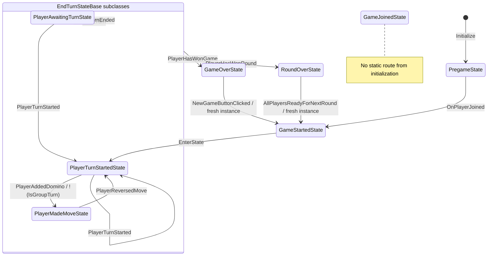

# Anticipated player states for the full Puremco profile

This inventories the local player interaction states anticipated for the selected [rulebook](TRAIN_DOMINOES_RULEBOOK.md). The user approved this direction and reviewed R-015–R-018 application policies on 2026-10-17. The standalone core is implemented; these Unity interaction changes remain pending. See [verification](RULES_ENGINE_VERIFICATION.md).

**Selected inventory: seven normal-flow states plus PlayerSessionSuspendedState under the adopted R-015 policy.** Doubles, drawing allowances, train markers, and scoring are authoritative data and rules; they do not each need a local state class.

This refines the earlier [player-state review](PLAYER_STATE_REVIEW.md): merge `PlayerTurnStartedState` and `PlayerMadeMoveState` into one permission-driven `PlayerActingState`. The earlier draft retained a separate commit-ready state. The selected design uses one acting state; a separate review lifecycle remains a future option only if a distinct review screen warrants it.

The [rules-engine implementation plan](RULES_ENGINE_IMPLEMENTATION_PLAN.md) still owns the intended authority/build boundary. The [project overview](PROJECT_STATE.md) and [generated current flow](PlayerStateFlow/current.md) describe the implementation. No gameplay classes, scenes or packages were changed for this inventory or the standalone engine. TASKS.md now records policy agreement and standalone verification separately from pending Unity integration.

## Engine contract additions agreed during standalone implementation

`CommitmentMode.Immediate` is the match-fixed default: accepted placements are irreversible, and a completed requirement automatically ends the turn/round. Optional `CommitmentMode.Draft` retains private previews, draw sealing, LIFO undo and End Turn. Both fit PlayerActingState; a separate commit-ready class is unnecessary.

One-tile announcements are manual, with an always-available button that gives harmless feedback if unnecessary. Announce/Challenge commands may come from Acting **or Waiting**, then use the shared pending tracker. Opponent challenges expire at the next accepted play/draw/pass; penalty draws are separate from ordinary play requirements. Public views/allowed actions and revision-stamped commands already exist in the core. No announcement, challenge or penalty state class is required.

Session suspension is adopted. The host gates core progression and may create a fresh match with 2–8 remaining participants and fresh readiness; it must not remove seats from an active match. Transport recovery and new-match UI remain U6 work. Late settings GUI and optional tiebreaker design are tracked in TASKS.md.

## Current flow: what exists today

There are eight concrete classes, of which seven have a recognized route from initialization. `GameJoinedState` is an unused runtime placeholder, although the regression harness currently references it. The source-derived graph expands to 21 transitions when shared handlers are counted for each concrete source.

The box groups inherited `EndTurnStateBase` handlers; it is not another runtime state. During legacy group play, placement stays in Turn Started. Draw and End Turn clicks send requests without directly changing state. Started requests engine placement and immediately enters Turn Started; it does not await a confirmed round/deal result.

Source snapshot: Working tree (HEAD bdf4793e8245d8cef2fc154076e2b28d801a32dc). State-source SHA-256: `c9953e65a6c184b49351329c1db4999e4cd92bc43ef7000008d75ac51338dda6`. This is static inspection, not Unity Play Mode or host/client verification.

## Proposed flow: responsibilities rather than one class per rule

The diagram below is a **simplified architectural proposal**. `Resolve` is a routing decision, not a state class. The available-session box groups the seven normal states; it does not require a new hierarchical-state-machine framework. The existing runner can remain flat.

```mermaid
stateDiagram-v2
    [*] --> Pregame

    state "Available session: seven normal states" as Available {
        state "PregameState" as Pregame
        state "RoundInitializingState" as Initializing
        state "PlayerAwaitingTurnState" as Waiting
        state "PlayerActingState" as Acting
        state "PlayerActionPendingState" as Pending
        state "RoundOverState" as RoundOver
        state "GameOverState" as GameOver
        state "Resolve latest phase, actor and request" as Resolve
        state Resolve <<choice>>

        Acting --> Pending: permitted play / draw / pass / undo / end / announce / challenge
        Waiting --> Pending: announce / challenge request
        Pregame --> Pending: readiness request
        RoundOver --> Pending: next-round readiness
        GameOver --> Pregame: host creates fresh match; collect readiness there
        Pending --> Resolve: matching outcome plus latest view

        Resolve --> Pregame: match not started; no relevant pending request
        Resolve --> Initializing: authoritative round setup in progress
        Resolve --> Waiting: round ready; another seat active
        Resolve --> Acting: round ready; local seat active
        Resolve --> Pending: current-phase request still unresolved
        Resolve --> RoundOver: ended round; no pending lifecycle request
        Resolve --> GameOver: ended match; no pending lifecycle request
    }

    Available --> Resolve: authoritative update, including setup and results
    Available --> Suspended: session unavailable / adopted R-015 policy
    state "PlayerSessionSuspendedState" as Suspended
    Suspended --> Resolve: recovery with usable authoritative synchronization
```

The shared authoritative-update route includes round/game completion while acting, observing, initializing, or awaiting a command. Completion of a new phase invalidates requests and callbacks belonging to the old phase. A readiness request for the *current* results phase can still be pending; it is not mistaken for an obsolete turn command.

A rejected request also goes through Resolve using the latest usable view. It does not blindly return to the state that originally sent it. An ordinary refresh that leaves the desired interaction mode unchanged updates the presentation without calling `SwitchState`; explicit self-transitions retain their current leave/re-enter semantics.

## Full anticipated state inventory

### Seven recommended normal-flow states

| Proposed class | What we have today | Responsibility and permitted local work | Entry and exit expectations | Remaining planning / implementation |
| --- | --- | --- | --- | --- |
| **`PregameState`** | Class exists; join handling and readiness are incomplete | Show roster/setup and readiness status. Submit only supported setup/readiness requests; board play is unavailable | Enter before a match starts. A join/spawn event alone must not make every player active. Advance when authoritative setup begins | Implement the agreed R-015 ready-roster/start controls, 2–8 seats, and failure feedback. Replace the current immediate join-to-start assumption |
| **`RoundInitializingState`** | New name/responsibility replacing `GameStartedState` in `GameStartState.cs` | Present loading/dealing/engine setup while waiting for a usable round view. No ordinary placement, draw, or End Turn | Enter on authoritative match/round setup. Exit to Acting for the active seat and Waiting for all others, after setup/deal is confirmed. Return to setup/error presentation if initialization is rejected | Separate authoritative setup from engine-mesh creation. Remove the immediate unconditional transition to active play. Initial dealing must not depend on the player manually pressing Draw |
| **`PlayerAwaitingTurnState`** | Class exists; it currently also supports legacy group waiting | Observe the public board, turn prompts and results. Local hand arrangement can remain a presentation feature. No active-turn mutation requests; permitted announcement/challenge requests still use Pending | Enter when a ready round belongs to another seat. Exit when the authoritative actor becomes local, a result ends the phase, or the session is suspended | Retire group-submission semantics; verify targeted notifications and privacy. Keep the same state for an opponent covering a double or taking ordinary play |
| **`PlayerActingState`** | Proposed merge of `PlayerTurnStartedState` and `PlayerMadeMoveState` | Handle local tile/destination selection, submit permitted play/draw/undo/end/pass requests, and display the current obligation and legal actions | Enter when the local seat owns the turn and no competing request is outstanding. A mutation request enters Pending. Outcomes return here if the local turn continues; a committed turn can lead to Waiting or a result | Make permissions and prompts come from authoritative queries/views. Delegate command forwarding and UI rendering to small collaborators. Do not hard-code Draw/End Turn availability from entry or tile count |
| **`PlayerActionPendingState`** | Missing; current code disables individual buttons optimistically | Track a single mutation request, prevent competing submissions, and display progress while retaining the relevant board/results presentation | Install the request token and response handling before transport can call back, including on a host. Reconcile matching outcomes against the latest phase/view. New terminal phases supersede old-turn callbacks | Define command/result correlation, duplicate/stale handling, rejection recovery, and uncertain-delivery behavior. Reuse the request mechanism for readiness; do not create one pending class per command |
| **`RoundOverState`** | Class exists; currently assumes a winner and performs local reset work | Display the ending reason, all round scores, totals and readiness status. An ended round may be blocked without an ending player | Enter on an authoritative round result. A Ready acknowledgment can return to the same results screen while others are not ready. Advance only when the server begins the next round or publishes the final match result | Replace winner-only notification assumptions; score/reset exactly once through the authoritative lifecycle. Confirm R-015 readiness and R-016 commitment controls |
| **`GameOverState`** | Class exists; single-winner display and restart coordination are incomplete | Display final totals and the winner list under the selected tie policy. Offer coordinated new-match/exit controls | Enter on an authoritative match result. A local click or readiness acknowledgment is not itself a full reset. A new match enters confirmed setup | Implement joint winners and fresh-match readiness under R-015. Fix the current mismatch between restart-ready input and the event this state consumes; define a complete shared reset |

### Session state under the adopted policy

| Proposed class | Current coverage | Responsibility | Planning boundary |
| --- | --- | --- | --- |
| **`PlayerSessionSuspendedState`** | No dedicated state or complete recovery flow | Under R-015, stop progression/submissions when a participant disconnects or the authoritative session becomes unavailable. Preserve the last usable presentation and pending-request identity | Recovery requires a usable authoritative resynchronization, not just a transport-connected signal. Resolve the current phase/actor/request after synchronization; do not restore a cached acting state blindly. Exact reconnect, abandonment and recovery-screen UX remain deferred |

Suspension is session-wide; it cannot be implemented solely by disabling a local player's buttons. The authoritative adapter/coordinator must also enforce the selected policy. If R-015 changes, revisit this class and its transitions rather than treating its inclusion as policy approval.

### An alternative to keep visible, not an additional required state

`PlayerTurnReviewState` could replace the current Made Move role **if** review/commit becomes a separate screen, input scheme, or substantial lifecycle. Under the recommended design, a commit-ready draft is an allowed-action configuration of `PlayerActingState`, so no review class is added initially. If a review state is chosen later, it must still support rejection, permitted undo, terminal results and session suspension.

## What stays as data, queries, or presentation

All rows below have been considered. They do not add to the recommended local-state count.

| Condition or activity | Proposed owner / representation | Why the local interaction mode need not change |
| --- | --- | --- |
| Ordinary play, including a player's first turn | Core turn requirement and active actor | Both use Acting with the ordinary legal-action set; Puremco has no group opening phase |
| Additional play after the first double | Core requirement identifying an additional play on that double or another eligible train | Acting displays the requirement and permits only queried actions |
| Conditional third tile after two doubles | Core requirement and the two relevant draft-double references | Acting requests a legal cover; the core prevents drawing or an illegal third double |
| Inherited open-double cover | Core required train/endpoint and access override | Acting displays the forced destination, including a normally private train |
| Drawing used / another attempt available | Core opportunity/requirement identity and draw history under R-017 | State entry, undo or re-entry must never renew an attempt |
| Playable drawn tile / legal pass / empty boneyard | Core legal actions and drawn-tile restriction | Acting exposes the permitted action; there is no dedicated draw or empty-pile class |
| Provisional draft, permitted undo and commit-ready/pass-ready status | Core draft/checkpoint plus queried allowed actions under R-016 | The same acting mode can show Undo, End Turn or Pass as appropriate |
| Personal train ownership, markers and the one shared train | Core train identities, access and marker data | Marking a train changes access, not the player's local class or train ownership |
| Selecting a tile, choosing a destination, hovering, arranging a hand | Local selection/presentation data; submit explicit tile/train IDs when placing | Separate selection subclasses are unnecessary for the current interaction design; revisit only if the UX gains genuinely distinct input lifecycles |
| Placement/flip/deal animation and sound | Presentation services with appropriate local input masking | Animation completion must not become the authority for advancing a turn |
| One-tile announcement / missed-announcement challenge | Core eligibility, omission window, manual commands and once-only effects under R-018; match-fixed penalty defaults to DrawOneTile | Acting/Waiting can submit through Pending; no separate player mode |
| Empty-hand or blocked round | `RoundResult` with reason and optional ending player | Both use RoundOver; no separate blocked-round or winner-player state |
| Tied lowest match scores | `MatchResult` winner list under adopted R-015 | GameOver can display all winners without a new state per outcome |
| Thirteen engines and rotating starter | Core match/round setup data | Reuse RoundInitializing for every engine; do not create per-round classes |
| Command rejection, timeout or malformed response | Request/adapter diagnostics and recovery presentation | Rejection reconciles to a usable mode. Timeout means uncertain delivery, not proof that the server rejected the command or that local work can be rolled back |

The selected commitment mode matters: Immediate final-tile placement ends the round on acceptance. In optional Draft mode a provisional final tile remains undoable until commitment, when final-tile ending precedes further obligations, even for a double.

## Coverage of every rulebook section

| Rule | Player states that present or request the behavior | Authority / essential consequence |
| --- | --- | --- |
| **R-001 Setup/dealing** | Pregame, RoundInitializing, then Acting or Waiting | Core creates the 91-tile catalog, selected deal counts and boneyard; only the active seat can act after setup |
| **R-002 Train identities** | Acting and Waiting display the board | Core maintains one personal identity per player and exactly one shared train, including empty positions |
| **R-003 Matching/orientation** | Acting requests placement; Pending awaits its outcome | Core validates the exposed endpoint and orientation; UI highlighting is advisory |
| **R-004 Turn/round order** | RoundInitializing, Acting, Waiting, RoundOver | Core rotates actor/starter and progresses through all thirteen engines |
| **R-005 First turns** | Ordinary Acting/Pending/Waiting flow | Retire the simultaneous opening/group-submission path; no opening state is added |
| **R-006 First-turn inability** | Acting and Pending | Use the same authoritative draw/pass procedure as later turns |
| **R-007 Turn completion** | Acting submits permitted End Turn/Pass; Pending reconciles | Advance to Waiting or results only after accepted commitment; placement alone does not always finish a turn |
| **R-008 Inherited open double** | Acting with a forced-cover prompt; Waiting observes | Core constrains the train and overrides ordinary private access where required |
| **R-009 Eligible trains** | Acting selection/highlighting | Core provides eligible destinations, including immediate access to the shared train |
| **R-010 Draw/pass** | Acting and Pending | Core rejects strategic/repeated draws and derives playable-drawn-tile, pass and empty-boneyard behavior |
| **R-011 Double follow-ups/two doubles** | Repeated Acting/Pending interactions within one turn | Core distinguishes additional play from inherited cover, checks the held third tile and applies final-tile precedence |
| **R-012 Markers/ownership** | Acting and Waiting render updated train views | Core changes markers without transferring ownership or creating another shared train |
| **R-013 Round endings** | RoundOver or GameOver preempts the old turn interaction | Core determines empty-hand/blocked endings after relevant access changes; ending notifications must not require a winner |
| **R-014 Scores/notification and R-018 challenges** | RoundOver, GameOver and transient announcements | Core sums pips, records scores and validates manual announcement/challenge commands; Acting/Waiting/Pending present them without another state |
| **R-015 Match management — adopted** | Pregame, Pending, RoundOver, GameOver; conditional SessionSuspended | Implement readiness sets, joint winners, fresh-match reset and suspended progression. Repeated clicks must not advance twice |
| **R-016 Preview/undo — adopted** | Acting and Pending, with an optional future review UX | Core enforces LIFO undo, draw sealing, privacy and commitment. Local state changes cannot undo a draw or renew its allowance |
| **R-017 Operational interpretations — adopted** | Acting prompts and Pending outcomes | Core tests one draw attempt per requirement, the bounded two-double procedure and the final-tile exception |

## How to split the implementation responsibilities

Use a shallow local state machine with a few focused collaborators:

- **Rules core:** authoritative match, round and turn conditions; legal actions, train access, draw/undo boundaries, scoring and results. It has no Unity/Netcode dependency.
- **`PlayerStateCoordinator` — proposed:** subscribe once to authoritative player-view and command-outcome updates; reconcile lifecycle, actor and relevant pending request; select the local interaction mode. It does not mutate a second copy of the game rules. It also handles result precedence and session suspension consistently across modes.
- **Pending-request tracker — proposed:** correlate command kind and request/phase identities, suppress competing local submissions, and distinguish settled, stale and uncertain outcomes. Server-side deduplication/actor validation remain in the authoritative adapter, not this local tracker.
- **Input/command adapters — proposed:** expose small testable interfaces for input, commands and notifications, keeping state classes independent of concrete `GameSession`/manager classes.
- **Turn/results presenters — proposed:** render allowed actions, obligation prompts, selection, scores and effects from the filtered view. Do not recompute legal moves merely to decide which button to enable.
- **Concrete states:** own the relevant local input/presentation lifecycle and balanced entry/exit work. Acting remains small by delegating rendering, command forwarding and rule decisions to their respective owners.

This would replace the mixed waiting/winner subscriptions in `EndTurnStateBase` with common authoritative-view routing. It is a proposed responsibility change, not simply renaming the base class. The factory cache remains registration-free. Some explicit routing policy is still necessary; its purpose is selecting a mode from meaningful conditions, not listing every state constructor.

The diagram extractor currently follows state methods and context initialization. **Extend its supported entrypoints/tests before moving transitions into a separate coordinator**, so the developer's generated map continues to reflect the code. Do not move calls outside its scope and accept a misleading sparse graph.

## Existing classes to merge, replace or retire

| Current class | Proposed disposition |
| --- | --- |
| `PregameState` | Retain and complete its setup/readiness responsibility |
| `GameStartedState` | Replace/rename as RoundInitializing; await confirmed setup |
| `PlayerTurnStartedState` | Merge into permission-driven Acting |
| `PlayerMadeMoveState` | Merge into Acting; retain a separate review mode only if the UX justifies it |
| `PlayerAwaitingTurnState` | Retain and remove legacy group-opening semantics during integration |
| `RoundOverState` | Retain as result presentation; remove responsibility for independently deciding/resetting the authoritative round |
| `GameOverState` | Retain as match-result/coordinated restart presentation |
| `GameJoinedState` | Retire after full reference review. The current Off-mode regression check uses it as a neutral destination and would need a replacement test fixture |
| `EndTurnStateBase` | Rework/remove when common authoritative routing is introduced; review every inherited subscription and exit |

Do not add opening-chain/group-submission states, a state for each player/train, per-double subclasses, or per-command pending subclasses for the selected profile.

## Verification to plan alongside these states

- **State/coordinator tests:** setup sends only the active seat to Acting; ordinary view refreshes do not duplicate subscriptions; allowed buttons follow the view; acting/observing modes forward only their permitted inputs.
- **Pending tests:** install handling before immediate host responses; one request produces one effect; rejection restores current permissions; stale/duplicate replies cannot revive an old phase; uncertain delivery is reconciled; readiness acknowledgment alone does not advance the round.
- **Rule-linked core tests:** EX-001–EX-013, including extra play elsewhere, conditional two doubles, inherited cover on a private train, draw sealing/undo, final-tile double, blocked endings, score-once and joint winners.
- **Result/reset tests:** blocked rounds show without an ending player; all-ready advances once; new matches clear every relevant field; cached state instances and old callbacks do not retain round/turn/request data.
- **Suspension tests:** progression/submissions stop across every phase, in-flight outcomes remain correlated, and recovery derives the mode from a synchronized view.
- **Unity/host-client checks:** actual event targeting, RPC results/rejections, Inspector/UI wiring, private-hand/draft filtering and animation behavior. The existing stub-backed source checks cannot prove these.

The current flow was regenerated and the proposed inventory was exercised with the player-state skill's planning overlay. This document records recommendations and required verification, not passing evidence for the future behavior. Use the agreed matrix and R-015–R-018 policies during U6; standalone tests do not verify these local transitions or real RPC privacy.
