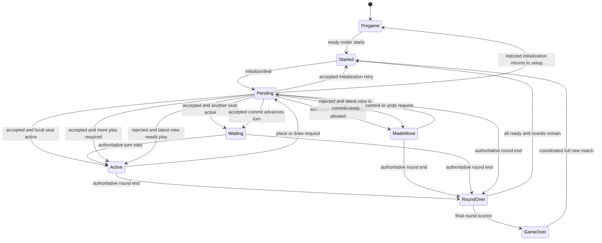
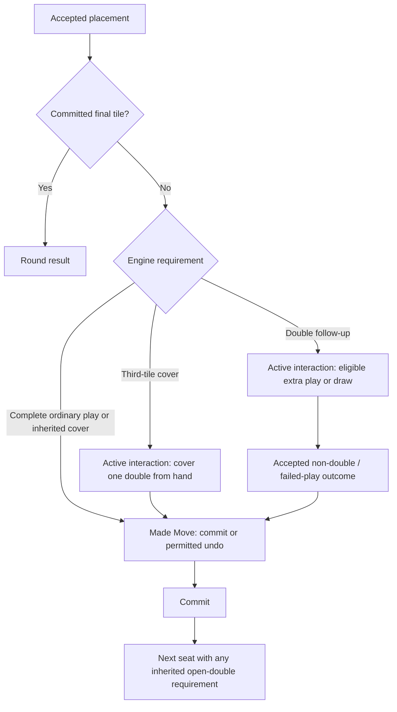

# Player states — Puremco rules mapping

This is the first STATE-001 review artifact. The user selected Puremco rules after withdrawing preferences based on uncertain memory. Use the [rulebook](TRAIN_DOMINOES_RULEBOOK.md) as the behavioral authority and the [engine plan](RULES_ENGINE_IMPLEMENTATION_PLAN.md) for implementation. The [project overview](PROJECT_STATE.md) remains a dated record of current code.

**Current code was statically inspected; nothing in this document is a successful play-test claim.** Proposed class changes below have not been made. Published baseline selection is settled; review the matrix and the rulebook's explicitly labeled app policies before state implementation.

## Three different meanings of state

| Kind | Example | Owner |
| --- | --- | --- |
| Match/round world state | Engine, seats, hands, boneyard, train identities, markers, active actor, scores | Authoritative rules engine |
| Turn requirement | Ordinary play, double follow-up, conditional third-tile cover, inherited open-double cover, draw attempt, legal pass, draft commit | Authoritative rules engine |
| Local interaction state | Waiting, choosing a tile, showing a provisional move, awaiting a command response | Unity player states / presentation |

Do not add a class for every combination of markers, selections, drawn tiles, and doubles. Engine queries derive available actions for the active local state. Disabled buttons merely reflect those decisions; they do not enforce them.

## Existing concrete states

Source: [states folder](../Scripts/Game/States), [GameSession](../Scripts/GameSession.cs), and [GameplayManager](../Scripts/Game/GameplayManager.cs). “Registered” means instantiated and retained by `GameStateContext`.

| State | Current entry / actions / transitions | Expected conditions and gaps | Planned disposition |
| --- | --- | --- | --- |
| `PregameState` — registered | Subscribes to join; calls join RPC and immediately enters Started. No explicit gameplay-button policy | Readiness/roster start gate missing; `Name` incorrectly reports Started; event startup ordering needs verification | Retain for setup, use authoritative readiness/start result; R-001, R-015 |
| `GameStartedState` — registered, file `GameStartState.cs` | Requests engine display, then immediately enters Turn Started | Does not await authoritative deal/setup. Current all-player entry serves group opening | Retain as round initialization; send only active seat to active play, all others to waiting; R-001, R-004–R-006 |
| `PlayerTurnStartedState` — registered | Enables Draw, disables End Turn. Forwards select/draw/end requests; draw toggles buttons immediately. Placement enters Made Move outside group play; during group play remains here | No selected/draw-used/follow-up model. Group branch conflicts with selected rules. Client can re-enter and reset buttons without a rule transition | Retain as active interaction, derive permissions from engine; R-003, R-005–R-012, R-017 |
| `PlayerMadeMoveState` — registered | Disables Draw, enables End Turn; forwards clicks/end; undo event returns to Turn Started | Assumes placement completes ordinary turn. Unconditional End Turn conflicts with double follow-up; one played-ID field cannot describe the two-double exception | Retain for a draft ready to commit; return to active interaction when additional play is required; R-007, R-011, R-016–R-017 |
| `PlayerAwaitingTurnState` — registered | Disables Draw/End Turn; turn-start event enters Turn Started | Receives shared round/game end events. No explicit round-initialization reason | Retain for other-player turns and setup wait; no group-submission wait in selected rules; R-004, R-015 |
| `RoundOverState` — registered | Reads winner/scores, shows UI; Ready sends RPC; all-ready resets local managers/meshes and constructs Started | Assumes a single round winner; blocked round may have none. Shared host/client reset path and readiness list need testing | Retain as presentation of a round result with reason, scores, and zero/one ending player; R-013–R-015 |
| `GameOverState` — registered | Shows scores/winner, enables restart-ready, listens to New Game; New Game constructs Started | No complete coordinated reset; restart-ready emits an event this state does not consume; single-winner model loses ties | Retain, display winner list and await coordinated new match; R-014–R-015 |
| `GameJoinedState` — unregistered | Empty entry/exit and no transitions | No active role; not created by context | Remove only after a full reference search; no replacement state required |

### Infrastructure

- `GameStateBase`: entry/exit plus optional update hook. Preserve balanced subscriptions.
- `GameStateContext`: constructs seven registered states, starts in Pregame, leaves old state before entering the next. Its Update hook is not forwarded by `GameSession`; current concrete logic is event-driven.
- `EndTurnStateBase`: common Await/TurnEnded → Awaiting, RoundWon → RoundOver, GameWon → GameOver subscriptions for all three current turn states. Refactor to authoritative **result** notifications so blocked rounds and joint winners are representable. It is not itself a phase.

## Required phase/action matrix

Rule and example IDs reference the rulebook; this table defines responsibilities rather than repeating the rules.

| World condition / phase | Eligible actor and allowed requests | Trigger / next condition | Current coverage | Implementation / evidence |
| --- | --- | --- | --- | --- |
| Roster not started | Registered participants Ready; coordinator starts only at ready threshold | Authoritative initialization produces engine/deal and first active seat | Pregame stub; hand draw based on empty hand | Engine setup + adapter roster; R-001, R-015 |
| Round initializing | Coordinator supplies validated deck; clients wait | Initialized result → active seat or waiting view | Started enters active immediately | Started + pending; test no command before setup |
| Ordinary active play, including first turn | Active seat selects locally; requests legal placement, or Draw when engine permits | Placement resolves to follow-up or ready-to-commit; Draw resolves to required drawn play or legal pass | Turn Started group/normal overlap | Engine requirements + active state; EX-002, EX-003, EX-010 |
| Personal/shared train access | Active seat may target an explicit train identity; inherited cover may override ordinary access | Accepted placement updates endpoint/ownership-preserving marker effect | Nullable owner and incomplete marker checks | Data/query, not new local state; EX-001, EX-004, EX-011 |
| First double in current draft | Active seat requests a legal extra play or a permitted follow-up draw | Cover or elsewhere non-double → commit-ready; qualified second double → third-tile requirement | Server `HasMadeMove` blocks further play | Engine requirement + active state; EX-005, EX-012 |
| Second double in current draft | Active seat must use an in-hand third tile covering one of the two doubles | Third placement → commit-ready, one exposed double remains | Missing | Engine requirement, not a new class; EX-006 |
| Open double inherited at turn start | Active seat covers required train, draws if unable, or reaches legal pass | Cover → commit-ready; failed draw → pass-ready | Missing priority/ownership exception | Engine access override; EX-011 |
| Commit-ready draft | Active seat End Turn or permitted Undo; no unrelated extra placement | Commit → round result or next player. Undo → recomputed requirement | Made Move partially covers this | Retain Made Move, permission-driven; EX-007, EX-010 |
| Command pending | Sender waits; no competing mutation requests; local selection may be visually retained | Accepted result → derive state from view. Rejection → restore latest authoritative permissions | Button disabling only | Add one `PlayerActionPendingState`; test rejection and duplicate acknowledgments |
| Another player's turn | Non-active seats observe public board/counts | Targeted active-seat change or round/match result | Awaiting partially covers this | Retain; never expose private hands/drafts |
| Round ended | Participants view scores; Ready once per player | All-ready → next engine, or final round → match result | Round Over assumes hand-empty winner | Result model + readiness set; EX-007–EX-009 |
| Match ended | View all winners; request ready/new-match protocol | All-ready → full initialization | Game Over local restart only | Engine reset and adapter coordination; EX-009 |

### States to add, retain, and avoid

**Add:** `PlayerActionPendingState` for all asynchronous mutation requests. A command token identifies the request; do not create a pending subclass for every command.

**Retain/refactor:** the seven registered states above. `PlayerMadeMoveState` means “draft can now be committed,” not “exactly one tile was clicked.” If the engine requires another play, remain in/return to Turn Started with a follow-up prompt.

**Do not add:** `PlayerOpeningTurnState`, opening submission/reveal states, a draw state per double, a selected-tile state, a train-public state, or per-player world-state classes mirroring every Unity class. Puremco has no distinct opening-construction phase. Selected IDs and hover/animation data remain local; draws, markers, and obligations remain engine data.

**Retire:** the group-opening path and associated completion-order rule during integration, and the unused joined placeholder after reference checks. Preserve metadata for any existing Unity asset moves; do not delete code in this documentation task.

## Proposed local transition diagrams

These describe future behavior; they are not diagrams of code already wired today.

While a final tile is provisional, it is commit-ready and follows R-016; the termination check runs at commitment. Terminal authoritative events take precedence over a delayed acknowledgment or animation callback. Pending cleanup must remove both transient and shared event subscriptions.

## Existing logic to reorganize

| Current owner | Move into core | Keep in Unity/adapter |
| --- | --- | --- |
| `DominoTracker` | Stable tile catalog, endpoint matching/orientation, hands, boneyard, legal placement, draft undo, pip totals | Local selection and visual flip/mesh mapping; remove Unity RNG from core |
| `TurnManager` / `TurnStatus` | Seat rotation, actor, turn requirements, draw-attempt history, active draft | Notifications derived from authoritative results; do not retain duplicate rule flags |
| `RoundManager` | Thirteen-round schedule, score ledger, blocked/empty-hand result, joint winner list | Round/game score presentation |
| `GameSession` | Hand mutation/placement/draw/pass/undo validation and lifecycle calculations | Authenticate sender, serialize commands/results/views, process once, broadcast permitted information |
| `GameplayManager` | Rule comparisons and dev-mode acceptance paths | Event bridge, mesh/layout/sound/UI coordination |
| Player states | No authoritative rule calculation belongs here | Input subscriptions, permitted action display, pending/rejection handling, presentation transitions |

The adapter converts a clicked engine/mesh into an explicit destination `TrainId`; the core should never guess the intended train from an arbitrary board domino ID. For an empty personal position, ownership is fixed even before a tile exists. A shared train must have an explicit kind, not merely any null owner.

## Rule-to-verification trace

| Rule group | Minimum evidence |
| --- | --- |
| R-001–R-004 | Complete catalog, exact selected deal table, five/nine train identities, stable ID mapping, first seat and thirteen-engine sequence |
| R-005–R-009 | No group phase; shared train available immediately; normal first-turn ending; only active actor; forced cover on private train |
| R-010–R-012, R-017 | No draw while playable; per-requirement limits; extra play elsewhere; two-double third-tile requirement; marker persistence and ownership |
| R-013–R-014 | Last-tile double, blocked board after access changes, correct totals, notification, no special blank penalty |
| R-015–R-016 | Deduplicated readiness, joint winners, full reset, irreversible draws, undo recomputation, no early next-turn activation |
| Local/transport behavior | Rejection restores usable input; duplicates do not mutate twice; stale acknowledgments cannot leave terminal states; private views hide opponents' hands/drafts |

## Fresh-session handoff

Review the source-checked Puremco baseline and app policies, then agree to this mapping before changing classes. Mark STATE-001 complete only after that review. STATE-002 records actual local host/client behavior separately from this static analysis. Engine scaffolding and integration follow the [implementation units](RULES_ENGINE_IMPLEMENTATION_PLAN.md#implementation-units); final art remains late priority.
