# Player states — Puremco rules mapping

STATE-001 policy/state review was agreed on 2026-10-17. The selected Puremco core and its live gameplay adapter/state integration are implemented as of 2026-10-18; integration verification remains in progress. The [rulebook](TRAIN_DOMINOES_RULEBOOK.md) owns behavior, the [engine plan](RULES_ENGINE_IMPLEMENTATION_PLAN.md) owns the core boundary, and the [integration guide](GAMEPLAY_INTEGRATION.md) describes actual symbols and data flow.

The selected inventory is implemented: seven normal states plus SessionSuspended. The [source-derived flow](PlayerStateFlow/current.md) should be regenerated after state changes; static graphs are not play-test evidence. The [legacy CLI runtime baseline](STATE_002_RUNTIME_BASELINE.md) is historical evidence of the replaced nested-RPC/group-readiness defect. Current adapter, localhost, live-service and presentation outcomes belong in [integration verification](GAMEPLAY_INTEGRATION_VERIFICATION.md); [standalone verification](RULES_ENGINE_VERIFICATION.md) is the earlier core-only report. The [gameplay review roadmap](plans/2026-10-18-gameplay-gap-analysis-and-review-plan.md) tracks remaining acceptance work without proposing additional states.

## Implemented phase/action matrix — 2026-10-18

| Condition | Local mode / owner | Implemented behavior |
| --- | --- | --- |
| No view / initial readiness | Pregame; host session adapter | Host creates a 2–8-person fixed roster. Each seat submits Ready; join alone does not start play |
| Awaiting deck / initial presentation | RoundInitializing; authoritative coordinator and presentation | `TryStartRound` supplies a validated deck. Interaction waits for round presentation completion; failed setup retains readiness/scores, reports participant feedback and allows a host-only correlated Retry through existing Ready (GAME-002) |
| Local actor | PlayerActing | Selection is local; explicit tile/train placement, Draw, Pass and Draft Undo/End Turn use core views and commands |
| Other actor | PlayerAwaitingTurn | Observe filtered views; still forward Announce/Challenge |
| Outstanding command | PlayerActionPending | One request installed before send; Retry preserves identity. Outcome matching and view freshness are independent |
| Round result | RoundOver | Show ending reason, scores/totals and Ready; no local rule reset. Blocked result permits no ending player |
| Match result | GameOver | Show all joint winners; host requests a fresh match and fresh readiness |
| Session unavailable/suspended | PlayerSessionSuspended | Block ordinary commands, offer synchronization/resume/new match. Retry reconnects/reclaims a fixed seat with a rotating host-issued secret; host Resume requires every fixed seat connected, including seats rebound to new transport IDs |
| Doubles / draw / markers / Draft readiness | Core data, not state classes | `PlayerViewDto` carries requirement, legal placements and allowed actions |
| Visual work | GameplayManager / GameplayPresenter | Ordered local batches; board input mask; terminal snap; cancellation/generation/watchdog recovery |

`PlayerStateCoordinator.Reconcile` owns every normal transition, with availability first, current pending request next, then authoritative phase/setup/actor. `ClientSession.Receive` retires obsolete requests on phase replacement or suspension before notifying that coordinator. A result-phase Ready can remain pending while the result screen stays visible. Same-mode updates refresh presenters without leave/enter; explicit runner self-transitions still re-enter. Concrete states balance their own input subscriptions; `ObservingStateBase` shares only announcement/challenge handlers, not rule decisions.

Selection and board masking live in `ClientSession`; its `BoardEnabled` combines active actor, playing phase, availability, pending absence and presentation readiness. `InputManager` renders real Unity Buttons cloned from its serialized Draw template for actions, train destinations and challenge targets. Button availability is advisory; the server validates every command.

**Local hand reflow (2026-10-18).** Resize presentation temporarily gates hand tile raycasts while its actual poses/hand zoom move. Automatic zoom-to-fit and rendered-body centering remain local presentation policy; [zoom verification](../../Tests/UnityIntegration/HAND_ZOOM_VERIFICATION.md) covers the follow-up. `GameplayPresenter`/`HandReflowController` defer to gameplay batches, selection coroutine completion, session availability and disposal. Board navigation and authoritative command permissions retain their existing owners; the state matrix and transition wiring are unchanged. [Verification and limits](../../Tests/UnityIntegration/HAND_REFLOW_VERIFICATION.md). The subsequent [hand wave](../../Tests/UnityIntegration/HAND_WAVE_VERIFICATION.md) changes per-tile cosmetic timing only; it adds no state or transition.

## Historical review and implementation targets — 2026-10-17

The matrices and diagrams below preserve the original inspected code and agreed target that motivated U6 / ENG-006. Their “current coverage,” “pending,” and “proposed” wording is historical. Use the implemented matrix above and integration guide for current ownership; do not recreate the removed group-turn, TurnStarted/MadeMove or Joined states.

## Three different meanings of state

| Kind | Example | Owner |
| --- | --- | --- |
| Match/round world state | Engine, seats, hands, boneyard, train identities, markers, active actor, scores | Authoritative rules engine |
| Turn requirement | Ordinary play, double follow-up, conditional third-tile cover, inherited open-double cover, draw attempt, legal pass, draft commit | Authoritative rules engine |
| Local interaction state | Waiting, choosing a tile, showing a provisional move, awaiting a command response | Unity player states / presentation |

Do not add a class for every combination of markers, selections, drawn tiles, and doubles. Engine queries derive available actions for the active local state. Disabled buttons merely reflect those decisions; they do not enforce them.

## Existing concrete states

Source: [states folder](../Scripts/Game/States), [GameSession](../Scripts/GameSession.cs), and [GameplayManager](../Scripts/Game/GameplayManager.cs). “Cached” means retained on first use by `GameStateContext`; transitions no longer require a central registration list.

| State | Current entry / actions / transitions | Expected conditions and gaps | Planned disposition |
| --- | --- | --- | --- |
| `PregameState` — cached | Subscribes to join; calls join RPC and immediately enters Started. No explicit gameplay-button policy | Readiness/roster start gate missing; event startup ordering needs verification | Retain for setup, use authoritative readiness/start result; R-001, R-015 |
| `GameStartedState` — cached, file `GameStartState.cs` | Requests engine display, then immediately enters Turn Started | Does not await authoritative deal/setup. Current all-player entry serves group opening | Retain as round initialization; send only active seat to active play, all others to waiting; R-001, R-004–R-006 |
| `PlayerTurnStartedState` — cached | Enables Draw, disables End Turn. Forwards select/draw/end requests; draw toggles buttons immediately. Placement enters Made Move outside group play; during group play remains here | No selected/draw-used/follow-up model. Group branch conflicts with selected rules. Client can re-enter and reset buttons without a rule transition | Merge into PlayerActingState, derive permissions from engine; R-003, R-005–R-012, R-017 |
| `PlayerMadeMoveState` — cached | Disables Draw, enables End Turn; forwards clicks/end; undo event returns to Turn Started | Assumes placement completes ordinary turn. Unconditional End Turn conflicts with double follow-up; one played-ID field cannot describe the two-double exception | Merge into PlayerActingState; draft readiness is queried data, not a separate lifecycle; R-007, R-011, R-016–R-017 |
| `PlayerAwaitingTurnState` — cached | Disables Draw/End Turn; turn-start event enters Turn Started | Receives shared round/game end events. No explicit round-initialization reason | Retain for other-player turns and setup wait; no group-submission wait in selected rules; R-004, R-015 |
| `RoundOverState` — cached | Reads winner/scores, shows UI; Ready sends RPC; all-ready resets local managers/meshes and constructs Started | Assumes a single round winner; blocked round may have none. Shared host/client reset path and readiness list need testing | Retain as presentation of a round result with reason, scores, and zero/one ending player; R-013–R-015 |
| `GameOverState` — cached | Shows scores/winner, enables restart-ready, listens to New Game; New Game constructs Started | No complete coordinated reset; restart-ready emits an event this state does not consume; single-winner model loses ties | Retain, display winner list and await coordinated new match; R-014–R-015 |
| `GameJoinedState` — unregistered | Empty entry/exit and no transitions | No active role; not created by context | Remove only after a full reference search; no replacement state required |

### Infrastructure

- `GameStateBase`: concrete-type name, entry/exit, optional update hook, and handler tracing. Preserve balanced subscriptions.
- `GameStateContext`: starts in Pregame, creates/caches states through typed factories, and leaves the old state before entering the next. Self re-entry and explicit fresh restart entries are preserved. It exposes current state, bounded trace history and verbose execution scopes; destruction disposes active subscriptions. Its Update hook is not forwarded by `GameSession`; current concrete logic is event-driven.
- `EndTurnStateBase`: common Await/TurnEnded → Awaiting, RoundWon → RoundOver, GameWon → GameOver subscriptions for all three current turn states. Refactor to authoritative **result** notifications so blocked rounds and joint winners are representable. It is not itself a phase.

## Required phase/action matrix

Rule and example IDs reference the rulebook; this table defines responsibilities rather than repeating the rules.

| World condition / phase | Eligible actor and allowed requests | Trigger / next condition | Current coverage | Implementation / evidence |
| --- | --- | --- | --- | --- |
| Roster not started | Registered participants Ready; coordinator starts only at ready threshold | Authoritative initialization produces engine/deal and first active seat | Pregame stub; hand draw based on empty hand | Engine setup + adapter roster; R-001, R-015 |
| Round initializing | Coordinator supplies validated deck; clients wait | Initialized result → active seat or waiting view | Started enters active immediately | Started + pending; test no command before setup |
| Ordinary active play, including first turn | Active seat selects locally; requests legal placement, or Draw when engine permits | Immediate placement resolves to follow-up/next turn/result; Draft placement resolves to follow-up or ready-to-commit; Draw resolves to required drawn play or legal pass | Turn Started group/normal overlap | Engine requirements + active state; EX-002, EX-003, EX-010 |
| Personal/shared train access | Active seat may target an explicit train identity; inherited cover may override ordinary access | Accepted placement updates endpoint/ownership-preserving marker effect | Nullable owner and incomplete marker checks | Data/query, not new local state; EX-001, EX-004, EX-011 |
| First double in current draft | Active seat requests a legal extra play or a permitted follow-up draw | Cover or elsewhere non-double → commit-ready; qualified second double → third-tile requirement | Server `HasMadeMove` blocks further play | Engine requirement + active state; EX-005, EX-012 |
| Second double in current draft | Active seat must use an in-hand third tile covering one of the two doubles | Third placement → commit-ready, one exposed double remains | Missing | Engine requirement, not a new class; EX-006 |
| Open double inherited at turn start | Active seat covers required train, draws if unable, or reaches legal pass | Cover → commit-ready; failed draw → pass-ready | Missing priority/ownership exception | Engine access override; EX-011 |
| Commit-ready draft | Active seat End Turn or permitted Undo; no unrelated extra placement | Commit → round result or next player. Undo → recomputed requirement | Made Move partially covers this | PlayerActingState with queried permissions; EX-007, EX-010 |
| Command pending | Sender waits; no competing mutation requests; local selection may be visually retained | Accepted result → derive state from view. Rejection → restore latest authoritative permissions | Button disabling only | Add one `PlayerActionPendingState`; test rejection and duplicate acknowledgments |
| Another player's turn | Non-active seats observe public board/counts | Targeted active-seat change or round/match result | Awaiting partially covers this | Retain; never expose private hands/drafts |
| Round ended | Participants view scores; Ready once per player | All-ready → next engine, or final round → match result | Round Over assumes hand-empty winner | Result model + readiness set; EX-007–EX-009 |
| Match ended or suspended abandonment | View joint winners when available; host creates fresh match, optionally with remaining seats | Fresh 2–8 roster → all-ready → initialization | Game Over local restart only | Core reset + trusted adapter coordination; EX-009 |
| One public tile remains | Participant Announce, including between turns; opponents Challenge within R-018 window | Announcement/challenge/next accepted play-draw-pass closes window | Missing | Rule data + Acting/Waiting request handling; no new class |
| Session unavailable | Host suspends core progression; clients display last usable view | Host resumes after usable synchronization or creates fresh match | Missing | PlayerSessionSuspendedState + host gate; R-015 |

### Selected local state responsibilities

Use the [anticipated inventory](ANTICIPATED_PLAYER_STATES.md): Pregame, RoundInitializing, PlayerAwaitingTurn, PlayerActing, PlayerActionPending, RoundOver, GameOver, plus PlayerSessionSuspended. Merge Turn Started/Made Move into Acting; replace Started's immediate active entry with confirmed initialization. Retire group opening and the unused Joined placeholder only during U6 and after reference review.

Doubles, draw attempts, markers, draft/commit readiness, announcements and challenges remain authoritative data/queries. No further local state is needed for rule implementation. Both Acting and Waiting must forward supported announcement/challenge actions; pending results reconcile against the latest phase and view. The announcement button remains available even when it returns harmless feedback.

## Selected future interaction flow

This simplified responsibility diagram describes U6, not current C# wiring. All modes also route authoritative round/match results and suspension through the shared coordinator. A refresh retaining the same mode does not re-enter it. Extend the source mapper before moving transition calls into that coordinator.

```mermaid
stateDiagram-v2
    [*] --> Pregame
    Pregame --> RoundInitializing: all ready; setup begins
    RoundInitializing --> Acting: confirmed local actor
    RoundInitializing --> Waiting: confirmed other actor
    Waiting --> Acting: authoritative actor becomes local
    Acting --> Pending: permitted mutation request
    Waiting --> Pending: announce or challenge request
    Pending --> Acting: latest view has local actor
    Pending --> Waiting: latest view has other actor
    Pending --> RoundOver: authoritative round result
    Pending --> GameOver: authoritative final match result
    RoundOver --> RoundInitializing: all ready; next deck supplied
    GameOver --> Pregame: host creates fresh match
```

Immediate mode needs no End Turn after a completed placement. Draft mode keeps End Turn/Undo permissions within Acting; provisional final tiles end the round only at commitment. Setup/results readiness may also use Pending without changing the underlying presentation. Results/suspension preempt pending work from an older phase, while requests belonging to the current readiness phase remain correlated.

## Existing logic to reorganize

| Current owner | Move into core | Keep in Unity/adapter |
| --- | --- | --- |
| `DominoTracker` | Stable tile catalog, endpoint matching/orientation, hands, boneyard, legal placement, draft undo, pip totals | Local selection and visual flip/mesh mapping; remove Unity RNG from core |
| `TurnManager` / `TurnStatus` | Seat rotation, actor, turn requirements, draw-attempt history, active draft | Notifications derived from authoritative results; do not retain duplicate rule flags |
| `RoundManager` | Thirteen-round schedule, score ledger, blocked/empty-hand result, joint winner list | Round/game score presentation |
| `GameSession` | Hand mutation/placement/draw/pass/undo validation and lifecycle calculations | Authenticate sender, serialize commands/results/views, process once, broadcast permitted information |
| `GameplayManager` | Rule comparisons and dev-mode acceptance paths | Event bridge, mesh/layout/sound/UI coordination |
| Player states | No authoritative rule calculation belongs here | Input subscriptions, permitted action display, pending/rejection handling, presentation transitions |

The adapter converts a clicked engine/mesh into an explicit destination `TrainId`; the core should never guess the intended train from an arbitrary board domino ID. For an empty personal position, ownership is fixed even before a tile exists. A shared train must have an explicit kind, not merely any null owner.

## Rule-to-verification trace

| Rule group | Minimum evidence |
| --- | --- |
| R-001–R-004 | Complete catalog, exact selected deal table, five/nine train identities, stable ID mapping, first seat and thirteen-engine sequence |
| R-005–R-009 | No group phase; shared train available immediately; normal first-turn ending; only active actor; forced cover on private train |
| R-010–R-012, R-017 | No draw while playable; per-requirement limits; extra play elsewhere; two-double third-tile requirement; marker persistence and ownership |
| R-013–R-014 | Last-tile double, blocked board after access changes, correct totals, notification, no special blank penalty |
| R-015–R-016 | Deduplicated readiness, joint winners, full reset, irreversible draws, undo recomputation, no early next-turn activation |
| Local/transport behavior | Rejection restores usable input; duplicates do not mutate twice; stale acknowledgments cannot leave terminal states; private views hide opponents' hands/drafts |

## Fresh-session handoff

The user approved this state direction and reviewed app policies individually on 2026-10-17. STATE-001 is complete as a decision task; no gameplay classes were changed by that agreement. STATE-002 records actual local host/client behavior separately from this static analysis. Engine scaffolding and integration follow the [implementation units](RULES_ENGINE_IMPLEMENTATION_PLAN.md#implementation-units); final art remains late priority.
