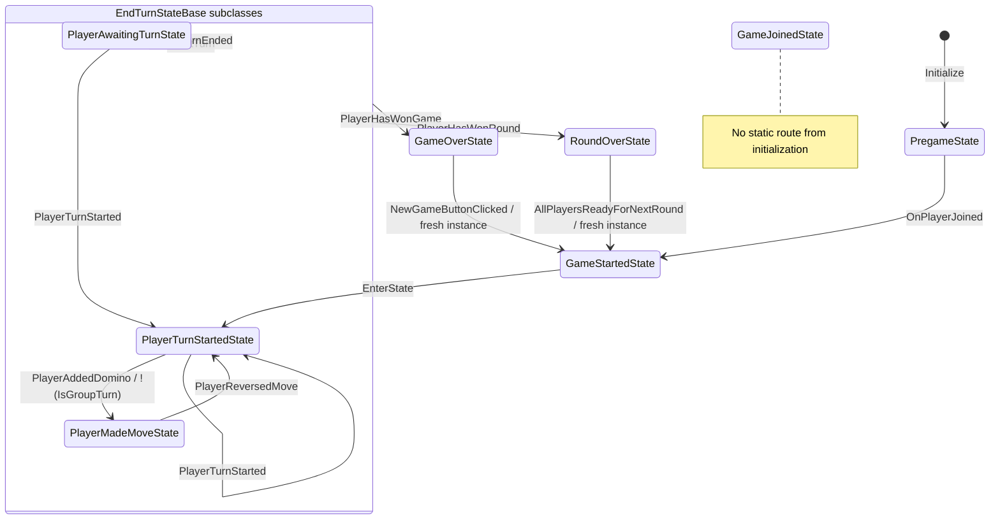

# Player-state flow — current source

Working tree (HEAD edcdb808247c969f6426a98da83e1401024c5037)

State-source SHA-256: `c9953e65a6c184b49351329c1db4999e4cd92bc43ef7000008d75ac51338dda6`.

Static source inventory, not runtime verification or an authoritative rules specification. Guards are source expressions, not evaluated predicates. RPC requests do not imply acceptance.

Boxes group shared inheritance; they are not additional runtime states. Shared arrows summarize matching inherited handlers; the table expands every concrete source. Self-arrows leave and re-enter the state.

## Transitions

| From | Trigger | Guard | To | Instance | Handler / location |
| --- | --- | --- | --- | --- | --- |
| [*] | Initialize | — | PregameState | cached / re-enter | GameStateContext..ctor (Assets/Scripts/Game/States/GameStateContext.cs:25) |
| GameOverState | ctx.GameplayManager.InputManager.NewGameButtonClicked | — | GameStartedState | fresh | GameOverState.InputManager_NewGameButtonClicked (Assets/Scripts/Game/States/GameOverState.cs:46) |
| GameStartedState | EnterState | — | PlayerTurnStartedState | cached / re-enter | GameStartedState.EnterState (Assets/Scripts/Game/States/GameStartState.cs:18) |
| PlayerAwaitingTurnState | ctx.GameplayManager.AwaitTurn | — | PlayerAwaitingTurnState | cached / re-enter | EndTurnStateBase.GameplayManager_AwaitTurn (Assets/Scripts/Game/States/EndTurnStateBase.cs:34) |
| PlayerAwaitingTurnState | ctx.GameplayManager.PlayerHasWonGame | — | GameOverState | cached / re-enter | EndTurnStateBase.GameplayManager_PlayerHasWonGame (Assets/Scripts/Game/States/EndTurnStateBase.cs:46) |
| PlayerAwaitingTurnState | ctx.GameplayManager.PlayerHasWonRound | — | RoundOverState | cached / re-enter | EndTurnStateBase.GameplayManagerPlayerHasWonRound (Assets/Scripts/Game/States/EndTurnStateBase.cs:40) |
| PlayerAwaitingTurnState | ctx.GameplayManager.PlayerTurnEnded | — | PlayerAwaitingTurnState | cached / re-enter | EndTurnStateBase.GameplayManager_PlayerTurnEnded (Assets/Scripts/Game/States/EndTurnStateBase.cs:55) |
| PlayerAwaitingTurnState | ctx.GameplayManager.PlayerTurnStarted | — | PlayerTurnStartedState | cached / re-enter | PlayerAwaitingTurnState.GameplayManager_PlayerTurnStarted (Assets/Scripts/Game/States/PlayerAwaitingTurnState.cs:25) |
| PlayerMadeMoveState | ctx.GameplayManager.AwaitTurn | — | PlayerAwaitingTurnState | cached / re-enter | EndTurnStateBase.GameplayManager_AwaitTurn (Assets/Scripts/Game/States/EndTurnStateBase.cs:34) |
| PlayerMadeMoveState | ctx.GameplayManager.PlayerHasWonGame | — | GameOverState | cached / re-enter | EndTurnStateBase.GameplayManager_PlayerHasWonGame (Assets/Scripts/Game/States/EndTurnStateBase.cs:46) |
| PlayerMadeMoveState | ctx.GameplayManager.PlayerHasWonRound | — | RoundOverState | cached / re-enter | EndTurnStateBase.GameplayManagerPlayerHasWonRound (Assets/Scripts/Game/States/EndTurnStateBase.cs:40) |
| PlayerMadeMoveState | ctx.GameplayManager.PlayerReversedMove | — | PlayerTurnStartedState | cached / re-enter | PlayerMadeMoveState.GameplayManager_PlayerReversedMove (Assets/Scripts/Game/States/PlayerMadeMoveState.cs:48) |
| PlayerMadeMoveState | ctx.GameplayManager.PlayerTurnEnded | — | PlayerAwaitingTurnState | cached / re-enter | EndTurnStateBase.GameplayManager_PlayerTurnEnded (Assets/Scripts/Game/States/EndTurnStateBase.cs:55) |
| PlayerTurnStartedState | ctx.GameplayManager.AwaitTurn | — | PlayerAwaitingTurnState | cached / re-enter | EndTurnStateBase.GameplayManager_AwaitTurn (Assets/Scripts/Game/States/EndTurnStateBase.cs:34) |
| PlayerTurnStartedState | ctx.GameplayManager.PlayerAddedDomino | !(ctx.GameplayManager.TurnManager.IsGroupTurn) | PlayerMadeMoveState | cached / re-enter | PlayerTurnStartedState.GameplayManager_PlayerAddedDomino (Assets/Scripts/Game/States/PlayerTurnStartedState.cs:78) |
| PlayerTurnStartedState | ctx.GameplayManager.PlayerHasWonGame | — | GameOverState | cached / re-enter | EndTurnStateBase.GameplayManager_PlayerHasWonGame (Assets/Scripts/Game/States/EndTurnStateBase.cs:46) |
| PlayerTurnStartedState | ctx.GameplayManager.PlayerHasWonRound | — | RoundOverState | cached / re-enter | EndTurnStateBase.GameplayManagerPlayerHasWonRound (Assets/Scripts/Game/States/EndTurnStateBase.cs:40) |
| PlayerTurnStartedState | ctx.GameplayManager.PlayerTurnEnded | — | PlayerAwaitingTurnState | cached / re-enter | EndTurnStateBase.GameplayManager_PlayerTurnEnded (Assets/Scripts/Game/States/EndTurnStateBase.cs:55) |
| PlayerTurnStartedState | ctx.GameplayManager.PlayerTurnStarted | — | PlayerTurnStartedState | cached / re-enter | PlayerTurnStartedState.GameplayManager_PlayerTurnStarted (Assets/Scripts/Game/States/PlayerTurnStartedState.cs:50) |
| PregameState | ctx.GameSession.OnPlayerJoined | — | GameStartedState | cached / re-enter | PregameState.GameSession_OnPlayerJoined (Assets/Scripts/Game/States/PregameState.cs:23) |
| RoundOverState | ctx.GameplayManager.AllPlayersReadyForNextRound | — | GameStartedState | fresh | RoundOverState.GameplayManager_AllPlayersReadyForNextRound (Assets/Scripts/Game/States/RoundOverState.cs:53) |

## Event reactions

Includes input/actions that may send requests without changing state. Actions are direct call-site inventory; consult source for guards and indirect helper effects.

| State | Event | Handler | Direct actions |
| --- | --- | --- | --- |
| GameOverState | ctx.GameplayManager.InputManager.NewGameButtonClicked | InputManager_NewGameButtonClicked | — |
| PlayerAwaitingTurnState | ctx.GameplayManager.AwaitTurn | GameplayManager_AwaitTurn | — |
| PlayerAwaitingTurnState | ctx.GameplayManager.PlayerHasWonGame | GameplayManager_PlayerHasWonGame | — |
| PlayerAwaitingTurnState | ctx.GameplayManager.PlayerHasWonRound | GameplayManagerPlayerHasWonRound | — |
| PlayerAwaitingTurnState | ctx.GameplayManager.PlayerTurnEnded | GameplayManager_PlayerTurnEnded | — |
| PlayerAwaitingTurnState | ctx.GameplayManager.PlayerTurnStarted | GameplayManager_PlayerTurnStarted | — |
| PlayerMadeMoveState | ctx.GameplayManager.AwaitTurn | GameplayManager_AwaitTurn | — |
| PlayerMadeMoveState | ctx.GameplayManager.InputManager.DominoClicked | InputManager_DominoClicked | ctx.GameSession.SelectDominoServerRpc(dominoId) |
| PlayerMadeMoveState | ctx.GameplayManager.InputManager.EndTurnClicked | InputManager_EndTurnClicked | ctx.GameSession.EndTurnServerRpc(); ctx.GameplayManager.InputManager.SetEndTurnButtonEnabled(false) |
| PlayerMadeMoveState | ctx.GameplayManager.PlayerHasWonGame | GameplayManager_PlayerHasWonGame | — |
| PlayerMadeMoveState | ctx.GameplayManager.PlayerHasWonRound | GameplayManagerPlayerHasWonRound | — |
| PlayerMadeMoveState | ctx.GameplayManager.PlayerReversedMove | GameplayManager_PlayerReversedMove | — |
| PlayerMadeMoveState | ctx.GameplayManager.PlayerTurnEnded | GameplayManager_PlayerTurnEnded | — |
| PlayerTurnStartedState | ctx.GameplayManager.AwaitTurn | GameplayManager_AwaitTurn | — |
| PlayerTurnStartedState | ctx.GameplayManager.InputManager.DominoClicked | InputManager_DominoClicked | ctx.GameplayManager.SoundManager.PlayRandomClickSound(); ctx.GameSession.SelectDominoServerRpc(dominoId) |
| PlayerTurnStartedState | ctx.GameplayManager.InputManager.DrawButtonClicked | InputManager_DrawButtonClicked | ctx.GameSession.DrawDominoesServerRpc(); ctx.GameplayManager.InputManager.SetDrawButtonEnabled(false); ctx.GameplayManager.InputManager.SetEndTurnButtonEnabled(true) |
| PlayerTurnStartedState | ctx.GameplayManager.InputManager.EndTurnClicked | InputManager_EndTurnClicked | ctx.GameSession.EndTurnServerRpc(); ctx.GameplayManager.InputManager.SetEndTurnButtonEnabled(false) |
| PlayerTurnStartedState | ctx.GameplayManager.PlayerAddedDomino | GameplayManager_PlayerAddedDomino | — |
| PlayerTurnStartedState | ctx.GameplayManager.PlayerHasWonGame | GameplayManager_PlayerHasWonGame | — |
| PlayerTurnStartedState | ctx.GameplayManager.PlayerHasWonRound | GameplayManagerPlayerHasWonRound | — |
| PlayerTurnStartedState | ctx.GameplayManager.PlayerTurnEnded | GameplayManager_PlayerTurnEnded | — |
| PlayerTurnStartedState | ctx.GameplayManager.PlayerTurnStarted | GameplayManager_PlayerTurnStarted | — |
| PregameState | ctx.GameSession.OnPlayerJoined | GameSession_OnPlayerJoined | ctx.GameSession.PlayerJoinedServerRpc() |
| RoundOverState | ctx.GameplayManager.AllPlayersReadyForNextRound | GameplayManager_AllPlayersReadyForNextRound | ctx.GameplayManager.DominoTracker.Reset(); ctx.GameplayManager.TurnManager.ResetForNextRound(); ctx.GameplayManager.ClientResetForNextRound() |
| RoundOverState | ctx.GameplayManager.InputManager.ReadyButtonClicked | InputManager_ReaadyButtonClicked | ctx.GameSession.PlayerReadyForNextRoundServerRpc() |

## Coverage and review

No static initialization route: GameJoinedState.

Sources are limited to `Assets/Scripts/Game/States`. External direct transitions, event emission/targeting, runtime ordering, dynamically created callbacks, and arbitrary control flow require review.

No extractor warnings for the recognized source patterns; this is not a completeness proof.
