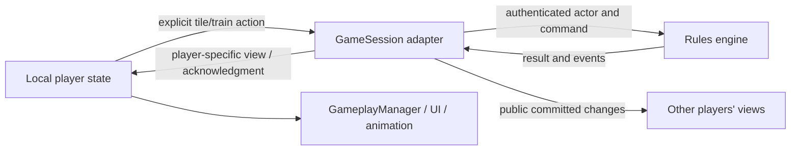

# TrainDominoesRulesEngine implementation plan

## Goal and authority

Make the selected Puremco game independently testable, then have Unity player states consume authoritative rule outcomes. Follow the [rulebook](TRAIN_DOMINOES_RULEBOOK.md) and [state mapping](PLAYER_STATE_REVIEW.md), not the superseded personal-only, simultaneous-opening, or strict-cover proposals. Preserve useful provisional-move UX without changing the published game implicitly.

**This file is a plan, not an implemented engine.** No C# project, assembly definition, test suite, or gameplay refactor is delivered with these documents. Before behavior-bearing units U3–U6, complete STATE-001's review of the matrix and the clearly identified R-015–R-017 app policies. U1–U2 can establish the pure source boundary without deciding a different rules variant.

The core owns game decisions; the host adapter authenticates participants and invokes it; clients consume restricted views. Unity animation or button state cannot advance rules on its own. Implement one selected profile, not a configurable collection of every researched variant.

## Product requirements

| Requirement | Governing rulebook / outcome |
| --- | --- |
| REQ-001 | R-001–R-004: double-twelve set, selected deal counts, 2–8 fixed seats, personal plus one shared train, thirteen engines |
| REQ-002 | R-005–R-009: sequential turns from the start, exact endpoint legality, ordinary access versus inherited-double access |
| REQ-003 | R-010–R-012, R-017: mandatory play, bounded draws, Puremco extra play and conditional two-double procedure, markers |
| REQ-004 | R-013–R-015: round results, score-once ledger, match winners, ready/reset coordination and one-tile notification |
| REQ-005 | R-016: useful draft undo without rerolling draws, losing obligations, or advancing another player prematurely |
| REQ-006 | Portable core, reproducible transitions, validated/rejected actions, private views, one authoritative rule implementation |

Do not build bots, a rules-editor UI, generic variant plug-ins, reconnect transport recovery, a new serializer, or final domino art in these units. NET-002 tracks serializer replacement independently. Retain engine support for eight players even though only four final colored sets are planned; use existing presentation where feasible and report any layout limitation explicitly.

## Planning contract

### Source organization and compatibility

Recommended layout to create during U1:

```text
Assets/Scripts/RulesEngine/
  TrainDominoesRulesEngine.asmdef
  Domain/
  Commands/
  Rules/
  Queries/
  Results/
RulesEngine/
  TrainDominoesRulesEngine.slnx
  global.json
  TrainDominoesRulesEngine/
    TrainDominoesRulesEngine.csproj
  TrainDominoesRulesEngine.Tests/
    TrainDominoesRulesEngine.Tests.csproj
    DomainTests.cs
    TurnRulesTests.cs
    LifecycleTests.cs
    ViewAndInvariantTests.cs
```

- **One core source tree:** Unity compiles the files under Assets; the external library project explicitly includes those same files with default compile discovery disabled. Keep `obj`, `bin`, test dependencies, and test sources outside Assets. Never also import the built DLL into Unity.
- **Targets:** library `netstandard2.1`; shared source uses supported C# 9 constructs, ordinary classes/structs rather than records/init-only setters; external tests `net10.0` with NUnit 4 and its compatible test adapter/Test SDK. Pin stable compatible package versions in U1, not floating versions. The inspected SDK is 10.0.402; pin it with patch roll-forward and document installation prerequisites.
- **Assembly boundary:** name/namespace `TrainDominoesRulesEngine`; `.asmdef` has no project assembly references, `noEngineReferences: true`, no precompiled dependencies, and auto-reference enabled for existing Assembly-CSharp consumers. Use `overrideReferences: true` with an empty precompiled list to keep plugin dependencies out. Do not add assembly definitions over all existing scripts as incidental cleanup.
- **Repository care:** use the separate solution above; leave Unity-generated root projects/solutions alone. Add narrow ignores for external build/test outputs and preserve Unity asset GUIDs/metadata. Future test frameworks stay outside the runtime library.

Evidence: `ProjectSettings/ProjectVersion.txt` specifies 6000.6.6f1; `ProjectSettings/ProjectSettings.asset` has API level 6, documented as .NET Standard 2.1. [Unity API level](https://docs.unity.com/en-us/engine/6000.0/script-reference/unityeditor/apicompatibilitylevel/net-standard), [C# 9 support/caveats](https://docs.unity3d.com/6000.6/Documentation/Manual/csharp-compiler.html), [assembly-definition format](https://docs.unity3d.com/6000.6/Documentation/Manual/assembly-definition-file-format.html). External runtime compatibility follows [.NET Standard's API contract](https://learn.microsoft.com/en-us/dotnet/standard/net-standard); successful dotnet compilation alone does not prove Unity compatibility.

### Domain types and state

| Model | Content / boundary |
| --- | --- |
| `DominoId`, `Domino` | Keep existing 0-based min-pip/ascending-max-pip catalog IDs; immutable pip pair and derived double/pip-total properties |
| `PlayerId`, seat order | Core-owned stable participant ID distinct from `ulong` transport client IDs; adapter supplies mapping. Seat order remains fixed through a match |
| `TrainId`, `TrainState`, `Placement` | Explicit Personal/Shared kind, owner for personal trains even while empty, marker, ordered oriented placements, actual endpoint. One stable shared ID; array index is not identity |
| `MatchState` | Selected profile/version, roster/seats, starting seat, round history, cumulative totals, readiness and match result |
| `RoundState` | Round index/engine, hands, ordered remaining boneyard, trains, turn, round result |
| `TurnState` | Actor, stable turn identifier, current play requirement, opportunity/draw history, provisional placements and undo checkpoint, open-double reference(s) needed during the current turn |
| `RoundResult`, `MatchResult` | Ending reason; nullable ending player for blocked rounds; all round scores; list of tied lowest-score match winners |

Separate a pending **additional play** from an inherited **must-cover** obligation. During a qualified two-double turn, track both draft doubles until the third tile covers one. At turn end there is at most one exposed obligation under R-017. Do not implement a chronological queue of arbitrary doubles from the rejected opening-chain variant.

Use read-only public snapshots with copied collections; commands create a validated next state, leaving the input unchanged. Internals may use mutable builders, but never expose them as mutable collections. Copies used for undo must not share writable hand/train lists. An authoritative tile exists in exactly one location: engine, hand, boneyard, committed placement, or provisional placement. Snapshot/history references do not count as extra playable copies.

### Public entry points and function decomposition

The planned primary API is **Apply(authoritative state, authenticated actor, command) → TransitionResult**. A result contains acceptance/error code, next state, and domain events. Rejection preserves the input state. Use normal validation errors rather than exceptions for illegal player moves; invalid internal invariants are programming failures.

Initialization takes the roster, initial seat, and an explicitly ordered 90-tile deck excluding the current engine. Validate the deck's complete membership and uniqueness before dealing. For subsequent rounds the coordinator provides another validated order. Randomization stays outside the core; fixtures supply fixed decks. The same initial state/decks and command sequence must reproduce outcomes without time, Unity RNG, singleton access, or callbacks.

| Function group | Planned operations | Responsibilities |
| --- | --- | --- |
| Catalog/setup | `CreateDominoSet`, `GetInitialHandSize`, `GetEngineForRound`, `CreateMatch`, `StartRound` | Stable IDs, exact edition counts, validated deck, initial actor/train positions |
| Queries | `GetLegalPlacements`, `GetAllowedActions`, `GetRequiredPlay`, `CanAccessTrain`, `GetPlayerView` | One legality policy shared by command validation and UI permissions |
| Placement | `ValidatePlacement`, `ApplyPlacement`, `ResolveOrientation`, `ResolveDoubleFollowUp` | Actor/hand/endpoint checks; additional play versus inherited cover; second-double feasibility |
| Draw/pass | `CanDraw`, `DrawForCurrentRequirement`, `CanPass`, `ApplyPass` | One attempt per opportunity, no strategic draw, drawn-tile requirement, marker consequences |
| Draft | `UndoLastPlacement`, `CanCommitTurn`, `CommitTurn` | LIFO changes before the draw/commit checkpoint; preserve irreversible information and requirements |
| Evaluation | `EvaluateRoundEnd`, `ScoreRound`, `GetMatchWinners` | Termination precedence, blocked position, idempotent score ledger, joint winners |
| Lifecycle | `SetReady`, `AdvanceRound`, `CreateNewMatch` | Readiness sets, engine progression, full reset; no transport calls |

Names can be refined while preserving these boundaries. Most rule helpers should be internal; keep the public facade small. Start with concrete commands for Place, Draw, Undo, EndTurn/Pass, Ready and coordinator-controlled initialization. Do not add core “select a mesh” commands.

The second-double validator must prove an in-hand third tile can cover one of the two doubles. Reject the second double without such a continuation, forbid drawing during the third-tile requirement, and evaluate final-tile victory before imposing further play. Test the combined cases rather than mirroring current booleans.

### Command and information flow



- The adapter identifies the sender from Netcode metadata and maps a clicked target to an explicit `TrainId`. Never trust a client-supplied actor or an arbitrary clicked board tile as authority.
- Process commands serially on the host. Use turn identity plus per-player request IDs to reject stale requests and return the original response for retries. Deduplication belongs at the adapter boundary, preventing duplicate draws/commits/readiness before calling Apply again.
- Full next-state objects are server-only. `GetPlayerView` exposes public board/markers/seat/count/score/obligation information, that player's hand/draft and allowed actions, but never opponents' tile IDs, boneyard order, or provisional events. Do not serialize full engine state into an all-client RPC.
- Selection/deselection stays local. Accepted outcomes drive state transitions; acknowledgment precedes optional animation completion. A terminal round/match result overrides delayed acknowledgments; a rejection restores usable permissions from the latest view.
- A draw freezes preceding draft placements. Its resulting sealed board changes may be public, but the drawn ID goes only to its owner. Undo cannot restore a draw opportunity, sealed double, or previous boneyard.
- Preserve existing transport payloads where their semantics still fit. The new explicit shared identity, obligation/view fields, blocked-result reason, and winner list may require focused DTO additions. Make those schema changes in U6 and test them; do not force incompatible state into a single-winner field or replace BinaryFormatter incidentally.

### Reorganizing existing classes

`DominoTracker` is the main catalog/hand/station extraction source; do not move its Unity RNG, selection data, and view concerns wholesale. Replace its compare-either-end rule with exposed-endpoint tests. `TurnManager` and `TurnStatus` become projections/adapters or are retired after the engine owns turns; do not synchronize two mutable authorities. `RoundManager` yields scoring/schedule authority to the core. `GameSession` retains transport orchestration. `GameplayManager`, meshes, layout, audio, and local states retain presentation.

## Implementation units

### U1. Establish the portable build boundary

**Tasks:** RULES-001 and ENG-001. **Depends on:** documentation baseline; policy-independent scaffolding may precede STATE-001 closure.

**Files:** runtime `.asmdef`, external library/test projects, solution, SDK pin and narrow ignore additions in the layout above. No scene, existing script, or package upgrades.

**Approach:** create a dependency-free runtime assembly compiled from the same source tree in both environments. Select and pin stable NUnit/Test SDK/adapter versions compatible with net10. Add a real catalog rule test when catalog code arrives; do not create assertions that merely test scaffolding.

**Verification:** external library builds; test discovery is configured; Unity imports the empty/pure assembly without engine/plugin dependencies or duplicate types. Build artifacts stay outside Assets. Record actual package pins and commands in a local developer README. No gameplay behavior change is claimed.

### U2. Define and characterize domain primitives

**Tasks:** RULES-002 and ENG-002. **Depends on:** U1. **Requirements:** REQ-001, REQ-006.

**Files:** Domain, setup/matching helpers, `DomainTests.cs`, `ViewAndInvariantTests.cs`. Add a read-only legacy catalog fixture/test harness where useful; do not couple the new core to MonoBehaviours just to characterize it.

**Approach:** characterize existing IDs and extract the 91-tile catalog. Add target-behavior tests for stable train identity, explicit exposed endpoints, edition-specific hand sizes, deck validation, setup and snapshots. Mark legacy defects as differences rather than encoding them as desired rules.

**Tests:** all unique pairs 0–12, ID parity with current creation loops, engine exclusion, exact hand/boneyard counts at 2/4/8 players, duplicate/missing/out-of-range deck rejection, five/nine identities, matching EX-002, input-state immutability.

**Done:** dotnet rule tests pass and Unity compiles shared source. A failed endpoint case in the old implementation is documented, not “preserved” as the new rule.

### U3. Implement sequential turns and Puremco doubles

**Tasks:** ENG-003; prepares RULES-004. **Depends on:** U2 and completed STATE-001 review. **Requirements:** REQ-002, REQ-003.

**Files:** Commands, placement/access/draw rules, required-play data, `TurnRulesTests.cs`.

**Approach:** build valid/rejected transitions test-first. Start immediately with one active seat; no group-opening draft/submission API. Share queries with command validation. Handle additional-play-anywhere and inherited-cover differently. Model the conditional third tile explicitly.

**Tests:** EX-001–EX-006, EX-010–EX-012; out-of-turn/foreign-tile/unknown-train rejection; shared train on first turn; marker persistence; no draw while legal; empty pile; second double without held cover; illegal third double; failed repeat draw; last-tile precedence.

**Done:** legal-action queries agree with accepted/rejected commands; all failures preserve state and tile conservation. No phase advancement depends on UI flags.

### U4. Implement commitment and undo boundaries

**Tasks:** ENG-004. **Depends on:** U3. **Requirements:** REQ-005, REQ-006.

**Files:** draft/checkpoint logic, `TurnRulesTests.cs`, `ViewAndInvariantTests.cs`.

**Approach:** preserve draft UX while sealing on draw. Store enough state to reverse orientation, hand membership, provisional train creation, marker effects, and requirements atomically. Undo is a permitted transition, not a generic restore-any-snapshot command.

**Tests:** undo first and second double; undo third cover restores the third-tile requirement; draw locks prior placements; drawn tile cannot return to pile; re-entry does not renew allowances; a provisional final tile does not score; commit advances exactly once; views expose only the actor's draft.

**Done:** EX-007/EX-010 hold across draw/undo/commit sequences, snapshots have no mutable aliasing, and saved inputs remain unchanged after transitions.

### U5. Implement scoring and match lifecycle

**Tasks:** ENG-005; supports STATE-004. **Depends on:** U4. **Requirements:** REQ-001, REQ-004.

**Files:** Results, round/match evaluation, readiness and reset rules, `LifecycleTests.cs`.

**Approach:** represent blocked rounds without requiring an empty-hand winner. Evaluate victory on commit, then block after marker consequences. Score into a once-per-round ledger. Readiness advances to a coordinator-provided new deck only after the gate is satisfied; guard round/phase identity on lifecycle commands.

**Tests:** EX-007–EX-009 and EX-013; all thirteen engines exactly once; first-turn last tile; score repetition rejected; blank zero; rotating starter; ready-click duplicates; retained roster but cleared per-round data; complete new match; tied totals; no legal moves under an inherited double; opened access preventing a false block.

**Done:** deterministic fixtures can complete a match, produce reproducible scores/winners, and initialize another without stale flags.

### U6. Integrate authoritative views and player states

**Tasks:** RULES-003, remaining RULES-004 integration, ENG-006, STATE-003/004 and NET-001. **Depends on:** U3–U5 plus STATE-002 runtime baseline. **Requirements:** REQ-001–REQ-006.

**Files:** existing GameSession/managers/DTOs/states; new `PlayerActionPendingState`; focused Unity adapter test assembly, for example `Assets/Tests/PlayMode/RulesAdapterTests.cs`. New test assemblies cannot directly reference predefined Assembly-CSharp: use black-box scene/component access for these tests, avoiding a wholesale runtime assembly migration.

**Approach:** integrate catalog/access queries first, then commands/turn authority, then lifecycle and local transitions. Switch the session's live mutation path to the core at one controlled boundary; do not interleave old and new hand mutations. Old queries may remain read-only projections until removed. Retire group-turn completion-order logic, preserve metadata, remove the unused joined state only after checking references. Add pending/rejection handling before relying on new legal-action buttons.

**Tests:** local host plus client reaches a first ordinary turn without group submission; extra play elsewhere and two-double sequence; engine private views survive actual DTO/RPC boundaries; unknown actor/out-of-turn/stale/repeated commands do not mutate; duplicate acknowledgments do not duplicate animations/turns/scores; eight players support nine logical trains; blocked result and joint winners reach all UIs; readiness/reset clears both host and client views.

**Done:** all core tests and relevant Unity integration checks pass; installed-scene smoke checks verify transitions with matching bypass off in the test setup. Restore/review settings rather than silently changing the saved development scene. Core-owned decisions have one implementation; dead branches/duplicate managers and abandoned attempts are removed. Report any unverified eight-player visual layout limitation separately from engine correctness.

## Verification contract

Planned external checks once U1 exists:

```sh
dotnet build RulesEngine/TrainDominoesRulesEngine.slnx
dotnet test RulesEngine/TrainDominoesRulesEngine.Tests/TrainDominoesRulesEngine.Tests.csproj
```

These are future commands, not checks already available or run. Add documented Unity Test Runner/batch invocation in U6 for the actual harness and installed editor; do not claim current tests exist. Avoid live Lobby/Relay calls unless that task explicitly needs them; local transport suffices for initial adapter evidence.

Every feature-bearing unit must have rule/example-linked tests. Invariant scenarios include unique tile location, unchanged input snapshots, rejected-command immutability, consistent endpoint orientation, valid active actor, unchanged owner on opponent play, private hand/boneyard data filtering, deterministic replay from explicit decks, and scoring once. Broader test repetition is warranted only by new changes/failures.

## Definition of done and review boundary

The **documentation delivery** is complete when the three linked documents and task/guidance updates are source-checked and the diff is documentation-only. That does not complete STATE-001, build the engine, or verify gameplay.

The **engine implementation** is complete only after U1–U6 acceptance evidence, rulebook/matrix updates, removal of replaced authorities, and passing external plus Unity checks. Keep progress in TASKS.md using stable IDs; do not mark code units done merely because they are described here. Review R-015–R-017 before behavior work; defer new variants rather than silently expanding the profile. Optional penalties and exact disconnect recovery remain separate future features, not blockers to defining normal Puremco play.
