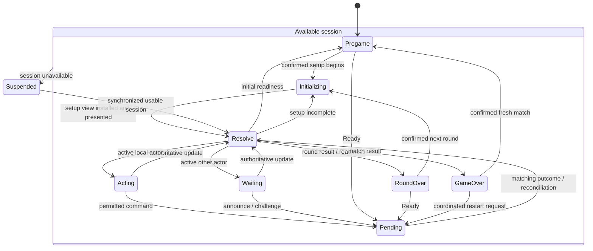

# Refactor gameplay integration around authoritative views and ordered presentation

**Intended destination:** `Assets/Docs/plans/2026-10-17-refactor-rules-gameplay-integration-plan.md`

**Authored context:** Saved on 2026-10-18 from the proposed implementation plan. This document specifies planned work; it does not assert implementation or verification completion.

## Goal Capsule

**Objective:** Developers can follow an action from player input through validation, synchronization, and animation, while players receive consistent Puremco gameplay.

**Approach:** Retain the flat interaction state machine, introduce one authoritative-view coordinator, and separate command delivery from presentation sequencing.

This plan expands **U6 / ENG-006** from the existing engine plan. Its U1–U8 identifiers are local work units; existing task and engine-unit IDs remain unchanged.

---

## Product Contract

### Summary and problem frame

The portable rules engine is implemented, but live gameplay still mutates legacy managers through RPCs. Local states mix button changes, requests, and presentation events. Some transitions happen before acknowledgment, while existing animation routines have inconsistent completion behavior.

Integrate the engine through one server mutation boundary. Make states describe the player’s interaction responsibility, and preserve existing animations through a separate presentation boundary.

### Requirements

**Gameplay and authority**

- R1. Preserve the agreed Puremco profile, including both commitment modes, announcements/challenges, readiness, joint winners, and suspension.
- R2. The rules engine becomes the only authority for hands, trains, obligations, turns, scores, and results.
- R3. Authenticate commands, preserve submitted position tokens, correlate outcomes, and prevent duplicate effects.
- R4. Send only recipient-filtered views and events.

**Developer clarity and presentation**

- R5. Use the selected seven normal interaction modes plus suspension; keep rule conditions and selection out of additional state classes.
- R6. Centralize authoritative update routing and make command, state, and presentation progress independently observable.
- R7. Preserve existing engine-entry, selection, draw, return, placement, and rearrangement animations.
- R8. Advance server rules immediately after acceptance. Each client waits for relevant board motion before enabling further board actions; Announce/Challenge does not wait for animation.

### Boundaries

Include the full adapter/state integration, necessary controls and scene wiring, animation completion/cancellation, and local multiplayer verification.

Defer new animation polish, final art, settings GUI, tiebreakers, BinaryFormatter replacement, persistent recovery, detailed reconnect UX, and optional debugger windows.

**Sources:** The supplied gameplay-integration handoff, agreed player-state inventory/matrix, rulebook, engine implementation plan, developer guide, and verification report remain authoritative inputs.

---

## Planning Contract

### Ownership and interfaces

| Component | Responsibility |
|---|---|
| `GameSession` | Netcode lifecycle, sender authentication, recipient targeting, transport |
| Authoritative match coordinator | Own the host-only snapshot, serialize commands and trusted lifecycle operations, cache outcomes |
| Client session model | Store the latest filtered view; reject older updates |
| Pending-request tracker | Track one outstanding local mutation, its originating phase, and delivery status |
| `PlayerStateCoordinator` | Resolve the appropriate interaction mode from session availability, view, pending request, and setup progress |
| Concrete states | Own mode-specific input subscriptions and presentation lifecycle |
| Presentation sequencer | Order visual operations, manage completion/cancellation, and apply local input masks |
| Existing mesh/layout/sound services | Execute presentation without deciding gameplay |

Use small interfaces for command submission, view/outcome notifications, input permissions, and presentation operations. Keep orchestration collaborators independent of Unity where practical so tests link the actual sources.

### Key technical decisions

- KTD1. **Retain the flat runner.** Preserve constructor factories, per-context caching, diagnostics, explicit fresh restart entries, and disposal. Ordinary same-mode view refreshes update presenters without re-entering the state. Explicit self-transitions retain their existing leave/enter semantics.

- KTD2. **Route authoritative updates once.** Replace `EndTurnStateBase`’s distributed winner/turn subscriptions with one coordinator. States do not individually interpret old winner events or reset authoritative managers.

- KTD3. **Install pending before transport.** Create the request identity, register pending handling, and enter Pending before sending. This supports immediate host responses.

- KTD4. **Separate acknowledgment from freshness.** A matching outcome settles a request even when acceptance produces no revision change. An old cached outcome may settle its request but cannot replace a newer view.

- KTD5. **Keep animations outside request completion.** Acceptance resolves Pending; animation remains a separate local busy condition. No animation callback invokes turn advancement, scoring, readiness, or another rules command.

- KTD6. **Preserve current animations through coroutine adapters.** Avoid a new tweening framework. Give existing routines explicit aggregate completion and cancellation. Unity supports yielding a coroutine to await completion; independently started routines require explicit coordination. [Unity coroutine documentation](https://docs.unity3d.com/6000.0/Documentation/ScriptReference/MonoBehaviour.StartCoroutine.html).

- KTD7. **Gate board input locally.** Combine authoritative permissions, request availability, and presentation readiness. Server progression never waits for clients’ animations. Announce/Challenge bypasses the animation mask; normal outstanding-request suppression still applies. *(session-settled: user-approved — chosen over immediate overlapping board input to keep motion understandable.)*

### Current and proposed state flow

The regenerated current map contains eight concrete classes and 21 expanded transitions, with no extractor warnings. The following **simplified current view** retains its shared exits:

```mermaid
stateDiagram-v2
    [*] --> Pregame
    Pregame --> Started: join
    Started --> TurnStarted: immediate entry
    TurnStarted --> MadeMove: accepted placement outside group play
    TurnStarted --> TurnStarted: turn-start event
    MadeMove --> TurnStarted: undo
    Waiting --> TurnStarted: turn-start event

    state "Legacy turn states" as Turns {
        TurnStarted
        MadeMove
        Waiting
    }

    Turns --> Waiting: await / turn ended
    Turns --> RoundOver: round-winner event
    Turns --> GameOver: game-winner event
    RoundOver --> Started: all ready; fresh instance
    GameOver --> Started: new game; fresh instance
```



`GameJoinedState` is an isolated placeholder. Group placement remains in TurnStarted; Draw and End Turn send requests without entering a pending state.

The **proposed flow** uses one shared resolver. It is a decision, not an additional state:



Authoritative terminal results route immediately from initialization, waiting, acting, and pending. A new result supersedes requests from the older gameplay phase. A Ready request within the current result phase remains correlated and retains the result screen underneath Pending.

Changes:

- Replace Started with RoundInitializing.
- Merge TurnStarted/MadeMove into Acting.
- Add ActionPending and SessionSuspended.
- Retain Pregame, AwaitingTurn, RoundOver, and GameOver.
- Retire the unused Joined placeholder after reference checks.
- Keep doubles, draw allowances, selection, and draft readiness as data.

### Command and update flow

```mermaid
sequenceDiagram
    participant Input
    participant Client
    participant Session as GameSession
    participant Host as Match coordinator
    participant Core as Rules engine
    participant Visuals as Presentation

    Input->>Client: permitted intent
    Client->>Client: install request and Pending
    Client->>Session: command + request ID + submitted token
    Session->>Host: authenticated participant + command
    Host->>Core: Apply
    Core-->>Host: outcome + next state + events
    Host->>Host: cache outcome; build recipient projections
    Host-->>Client: correlated outcome / filtered update
    Client->>Client: settle request; install fresh view; resolve mode
    Client->>Visuals: ordered presentation batch
    Visuals-->>Client: release local board mask
```

Transport additions must carry:

- Request ID, original position token, command kind, and explicit command arguments.
- Correlated acceptance/rejection and rule error.
- Recipient view with explicit train identities, permissions, obligations, results, and settings.
- Presentation event identities assigned before audience filtering.

Authenticate from RPC metadata, never a submitted actor ID. Scope outcome caching by match, participant, and request ID; reject reuse with different command content. Retries return the original outcome. Unknown delivery triggers reconciliation or retry of the same request, never rollback or submission under a new identity.

Apply fresh views monotonically. A synchronization response provides the current view and relevant request status; missing presentation history causes a snap to that view rather than guessed effects.

### Animation behavior

Build immutable presentation batches from each recipient’s consecutive filtered views plus permitted events. Core events alone lack train/orientation details and complete sealed-placement information.

- Sequence authoritative board changes in received revision order. Run independent movements within a batch in parallel and wait for all relevant movements.
- Capture each batch’s destinations from its own views; do not read changing live manager data during animation.
- Treat selection as local, replaceable motion. Cancel conflicting selection motion when placement begins.
- Preserve private Draft movement for the actor. Opponents animate placements only when published; sealing must not replay the actor’s already-presented placement.
- Track both latest authoritative view and last presented view. Board actions unlock when relevant presentation catches up.
- Complete empty/disabled-animation batches immediately.
- On terminal results, suspension, resynchronization, round replacement, or new match: cancel owned motion, invalidate callbacks, and reconcile meshes to the applicable view.
- Use a presentation generation alongside match/round identity. Old callbacks cannot unlock a new generation.
- Explicitly cancel child routines; stopping a parent is insufficient as an ownership policy.
- If presentation fails or exceeds a configurable safety budget, defaulting to ten seconds per batch, cancel and snap to the latest view. Log the failure and release the mask without changing rules.

### Compatibility and assumptions

Preserve Unity `6000.6.6f1`, installed packages, GUIDs, serialized references, and existing animation assets. Keep the core’s public API unchanged unless integration exposes a documented defect.

The saved scene still has matching bypass enabled, starts at round 2, and uses a development hand count. Verification must use an explicit test setup rather than silently rewriting those saved settings.

---

## Implementation Units

### U1. Characterize startup, gameplay, and existing motion

**Requirements:** R1, R7. **Dependencies:** None.

**Files:** `Assets/Docs/STATE_002_RUNTIME_BASELINE.md`; existing scene and presentation sources inspected without incidental changes.

Record reproducible local host/client setup and observed startup/deal, group submission, placement, undo, draw, scoring, and next-round behavior. Record existing animation behavior separately from selected target rules.

**Scenarios:** Host versus remote startup; repeated input during movement; draw/return and placement completion; next-round cleanup.

**Completion:** STATE-002 has passes, failures, and explicit untested cases. A blocking runtime defect is recorded before the live authority switch.

### U2. Establish orchestration seams and maintain source mapping

**Requirements:** R5–R6. **Dependencies:** U1 before gameplay replacement.

**Files:** New collaborators under `Assets/Scripts/Game/Integration`; existing state infrastructure; mapper scripts; `Tests/StateMachine/Program.cs`.

Introduce the narrow interfaces and client model. Extend mapper coverage for coordinator routing before moving transitions out of states. Keep routing policy in production source, with no separate transition registry.

**Scenarios:** Same-mode refresh avoids re-entry; explicit self-transition still re-enters; cached/fresh instances remain correct; disposal balances subscriptions; generated maps include coordinator guards and shared exits.

**Completion:** Actual source-linked state checks and mapper behavioral checks cover the new entrypoints.

### U3. Implement authoritative commands and filtered transport

**Requirements:** R2–R4. **Dependencies:** U2.

**Files:** `GameSession`, new host coordinator and DTO adapters; `Tests/GameplayIntegration/CommandBoundaryChecks.cs`; `Assets/Tests/PlayMode/RulesAdapterTests.cs`.

Keep new authority isolated until the controlled switch. Serialize submissions and trusted lifecycle operations; reconstruct submitted tokens; cache outcomes; build recipient projections.

**Scenarios:** Unknown sender, out-of-turn, stale token, invalid tile/train, identical retry, conflicting request-ID reuse, no-op Ready acceptance, and private draw/draft filtering after serialization.

**Completion:** Actual coordinator sources pass deterministic checks; black-box Unity tests exercise real RPC sender metadata and recipient routing.

### U4. Implement pending recovery and the selected local modes

**Requirements:** R3, R5–R6. **Dependencies:** U2–U3.

**Files:** State classes and coordinator; `Tests/StateMachine/Program.cs`; `Tests/GameplayIntegration/PendingRequestChecks.cs`.

Implement shared resolution and mode-specific inputs. Selection stays local; placement submits explicit tile/train identities. Ready acknowledgment does not independently initialize a round.

**Scenarios:** Immediate host reply, rejection, unchanged-revision acceptance, newer view before acknowledgment, duplicate/old outcomes, uncertain delivery, terminal preemption, and same-phase readiness.

**Completion:** Every outcome returns to the appropriate current mode without duplicate handlers or stale-state revival.

### U5. Wrap and preserve existing animations

**Requirements:** R7–R8; KTD6–KTD7. **Dependencies:** U2–U4.

**Files:** Presentation sequencer, `LayoutManager`, `Mover`, animation helpers; `Tests/GameplayIntegration/PresentationQueueChecks.cs`; `Assets/Tests/PlayMode/GameplayPresentationTests.cs`.

Replace fire-and-forget completion assumptions with owned operations. Correct aggregate station completion, child cancellation, and conflicting transform ownership while retaining existing curves and motion.

**Scenarios:** Delayed rotation outlasts translation; multiple tiles complete once; empty batch; zero/one-tile hand layout; duplicate event; Draft sealing; reset mid-draw; callback after disposal; presentation failure recovery.

**Completion:** Fake-operation checks prove ordering; Unity checks prove actual transforms, completion, cancellation, and input masking.

### U6. Switch live gameplay to core authority

**Requirements:** R1–R4. **Dependencies:** U1–U5.

**Files:** `GameSession`, legacy managers and DTO consumers; `Tests/GameplayIntegration/GameplayFlowChecks.cs`; `Assets/Tests/PlayMode/RulesAdapterTests.cs`.

Switch commands and their consumers together. Remove group opening and replaced rule mutations. Keep any remaining legacy models as read-only presentation projections with clearly named ownership.

**Scenarios:** Sequential first turn, legal draw/pass, extra play elsewhere, two doubles, inherited cover, Immediate automatic advancement, Draft undo/sealing, and nine logical trains at eight players.

**Completion:** No live command mutates both engine and legacy authority; rejected commands preserve state; peers converge.

### U7. Complete lifecycle, controls, and suspension

**Requirements:** R1, R5, R8. **Dependencies:** U6.

**Files:** Input/result UI, session lifecycle and participant mapping; `Tests/GameplayIntegration/LifecycleChecks.cs`; `Assets/Tests/PlayMode/SessionLifecycleTests.cs`.

Add Pass, Announce, Challenge, and appropriate Draft controls. Render blocked results and joint winners. Freeze match seats independently of spawned player objects. Gate initialization against startup-order races and correct local-player cleanup during remote despawn.

**Scenarios:** Duplicate readiness starts once; thirteen rounds; blocked result without winner; announcements while waiting or animating; private penalty draw; disconnect in every mode; synchronized resume; fresh match clears scores/readiness/pending/motion.

**Completion:** Host/client lifecycle agrees. Detailed reconnect transport remains deferred; unavailable sessions cannot continue gameplay.

### U8. Verify integration and publish developer guidance

**Requirements:** R1–R8. **Dependencies:** U6–U7.

**Files:** Existing overview, state matrix, anticipated states, debugging guide, generated flow, and `TASKS.md`.

Document one placement, one draw, one rejection, and one round transition through the final ownership chain. Extend existing diagnostics with request identity/status and presentation generation/status, excluding private tile contents.

Compare actual states with the proposal, regenerate the checked-in map, remove abandoned code, and attach evidence to existing task IDs.

**Completion:** Developer documentation matches source; tasks close only against their individual acceptance criteria.

---

## Verification Contract

- Run the existing standalone rules suite and Unity compile checks using the pinned SDK workflow in `RulesEngine/README.md`.
- Run source-linked state checks and new orchestration checks against production sources.
- Run mapper tests, strict mapping, and actual-versus-proposed comparison.
- Add black-box Play Mode tests for predefined `Assembly-CSharp` components; avoid a broad runtime assembly migration solely for test access.
- Verify real local host/client transport, host immediate replies, serialization privacy, animations, and lifecycle transitions.
- Exercise both commitment modes, both penalty settings, and eight-player/nine-train capacity. Report visual limitations separately.
- Record static inspection, automated checks, local play, and untested scenarios distinctly. Live Lobby/Relay verification is separate.

## Definition of Done

The engine owns all accepted rule mutations; local states consume authoritative projections; correlated outcomes recover cleanly; existing animations complete or cancel safely; and presentation timing cannot advance rules.

The generated state map and developer guide explain the implemented flow. Core, orchestration, Unity, and local multiplayer evidence meet the relevant task criteria. Replaced authorities and abandoned implementation paths are removed, and unrelated scene settings, assets, and packages are preserved.
