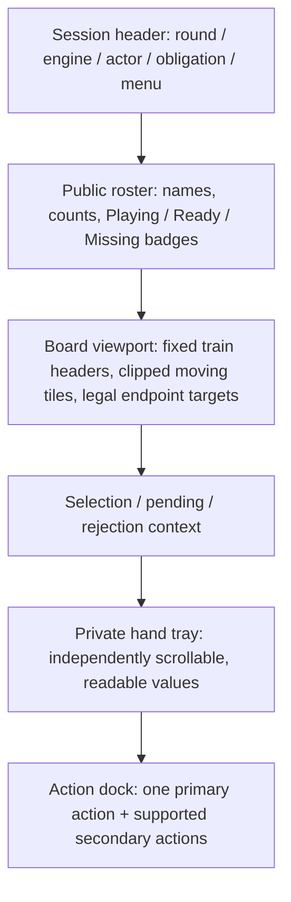
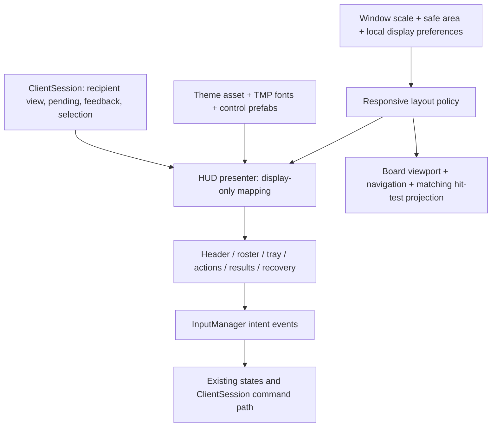

# Modern, touch-friendly gameplay UI for desktop and iPad

## Goal Capsule

**Objective:** Make the game feel like a polished digital tabletop: readable at a glance, comfortable to operate with a finger or mouse, and visually calm while several trains grow. A player should immediately understand whose turn it is, what they can do, and where their selected tile can go.

**Means:** A reusable visual theme, responsive screen regions, clear typography, accessible controls, and consistent gameplay/result/recovery panels built around the existing authoritative projections and navigation.

**Success:** Required controls and private-hand values remain readable and reachable on desktop and iPad, the board retains useful own/shared-train context, and the user approves paired normal-speed captures plus interactive checks. Creating this plan does not implement or validate the design.

---

## Context and observed problems

Planning baseline: Unity 6000.6.6f1, uGUI 2.6.0, Input System 1.20.0, TextMesh Pro components, existing 3D dominoes and navigation. Recheck source before implementation; the working tree contains uncommitted gameplay and review-tool changes that must be preserved.

The actual 1280×720 actor/waiting gallery shows:

- A flat blue field with little visual separation between game information, the board and the hand.
- Small upper-left status text and small upper-right controls, competing with oversized in-world train labels. There is no coherent typography hierarchy.
- Row labels repeated in both UI buttons and world text. Endpoint markers and labels can collide; earlier navigation probes also identified tiles sliding beneath the row-control area.
- A long action column mixing game actions, announcements and camera navigation. The relationship between a selected tile and a legal train is weak.
- Hand tiles almost touching the bottom edge, with little padding. The hand should have a deliberate tray and safe-area clearance.
- Important multiplayer/recovery/result views that need a visual system beyond the ordinary-play screenshot.

The large `REVIEW FRAME TEXT` box and development-build watermark are harness annotations, not product elements to redesign into the game. The newer console/start overlays are already fixed; preserve that work. Desktop captures are not evidence of actual iPad usability, portrait layout or OS accessibility behavior.

**Source anchors:** `Assets/Scripts/Game/InputManager.cs` creates buttons/status/results dynamically from a serialized button template; `Assets/Scripts/Game/Navigation/BoardRowControls.cs` uses fixed widths and 20–34-unit row button heights; `Assets/Scripts/Game/Navigation/BoardNavigator.cs` owns fixed gutters and the board/hand coordinate spaces. `LayoutManager`, `MeshManager` and `GameplayPresenter` own world objects and motion. The scene canvas currently uses Scale With Screen Size and a height-biased 1080 reference. Simply changing TMP font sizes would leave scaling and layout problems intact.

See `Tests/UnityIntegration/GAMEPLAY_GAP_VERIFICATION.md`, `Tests/UnityIntegration/REVIEW_EXPECTATIONS.md`, and the existing gameplay-gap and VIEW plans under `Assets/Docs/plans`. Reproduce missing views through the isolated review harness during implementation; do not infer them from the baseline screenshot.

---

## Product Contract

### Requirements

**Visual clarity and identity**

- R1. Use one cohesive tabletop theme with a deliberate text hierarchy, spacing, surfaces and control states. The proposed direction below is a recommendation, not a previously approved brand.
- R2. Keep current actor, round/engine, immediate obligation, selected tile and pending/rejected status distinguishable without reading a paragraph or relying on color alone.
- R3. Preserve the user's domino art and future four-color assets. Seat identity, train access and action legality must remain separate visual concepts, supporting all 2–8 seats.

**Desktop and touch operation**

- R4. Support mouse/keyboard and touch with the same tap/click-to-select, explicit-train-to-place flow. No required hover, double tap, precision drag or drag-to-place interaction.
- R5. Keep touch hit regions at least 44×44 iPad points; use a 48×48 logical-unit design target and 56-unit primary-action height. Maintain size through rotation, high-density displays and UI scaling. User scale reductions must not reduce touch hit regions below the native-point minimum; reflow instead.
- R6. Reflow for desktop windows, iPad landscape/portrait and supported multitasking widths. Keep the private hand and essential actions outside board scrolling/zoom; preserve safe areas and readable type rather than shrinking everything to fit.
- R7. Preserve pan, zoom, Fit, playable-end access and follow/inspection behavior. Show own and shared train identity and their playable endpoints together where space allows; all other trains remain identifiable and reachable.

**Lifecycle and correctness**

- R8. Give readiness, round results, joint winners, delivery uncertainty, failed setup and suspended/reconnecting sessions the same visual quality as ordinary play. Announce/Challenge retain their existing availability during board motion.
- R9. Render only the local recipient view. Restyling must not add authority, reveal private hands/drafts, change challenge timing, auto-announce, auto-end a turn, or make animation completion decide rules.
- R10. Ship with paired actual-frame evidence and real-input/device acceptance. Automated geometry and OCR checks support, but do not substitute for, user review of readability and visual appeal.

### Key flows and acceptance examples

- F1 / AE1. On a local turn, the header reads “Your turn”; a short obligation explains the next legal kind of action. Selecting a hand tile highlights explicit legal train targets. Tapping a target submits the same command as today, once. An invalid/stale request leaves the latest board usable and explains the rejection.
- F2 / AE2. A waiting player sees the actor, public obligations and accepted public changes; their private hand stays readable. Board mutation controls are inactive, while supported announcement/challenge controls remain available. No opponent preview appears.
- F3 / AE3. A player manually inspecting a long train keeps that position after an opponent move; an unobtrusive “New tile · End” affordance returns to its end. Fit and normal zoom restore readable, selectable tiles without covering the hand.
- F4 / AE4. Rotation, window resize or larger text reflows the shell without submitting a command, losing selection or changing readiness. Any required presentation resync follows existing cancellation/generation rules; navigation is clamped to the new viewport rather than reset to another train.
- F5 / AE5. Setup failure shows a persistent explanation and the host's Retry. A disconnect names missing seats and offers the appropriate Retry/Resume/New match controls. Round results show all scores; final results show every joint winner. Recovery actions remain server-validated.

### Scope boundaries

This is a presentation modernization. It includes a small local display-preferences panel for text size, UI scale and reduced motion; this is independent of match settings. Do not expose/change commitment mode, penalty settings or other rules through that panel.

Out of scope: rule/core/network redesign, new player states, asynchronous play, spectator support, new waiting-player planning features, full onboarding, chat, avatars/accounts, monetization, package upgrades, a UI Toolkit migration, final domino-art import, or a second dark/light theme. Screen-reader platform integration requires a separate feasibility scope; this plan must not claim VoiceOver/Narrator support from TMP labels or the installed accessibility module alone.

This work can satisfy portions of VIEW-002/003 and QA-001/002/003. It does not close the independent GAME-003 admission gap or remove the existing ART-001 gate.

---

## Recommended visual system

### Direction: quiet contemporary tabletop

Use a deep green-teal playing surface, warm ivory tiles, clear light text on the table, and restrained cream panels for results/settings. Prefer flat color, subtle tonal variation, one soft elevation shadow and modest rounded corners. Avoid heavy glass blur, neon outlines, decorative train imagery behind tiles, or multiple competing accent colors.

Candidate tokens below are starting values; verify actual rendered contrast during implementation, especially composited/disabled states.

| Token | Starting value | Intended use |
| --- | --- | --- |
| Table | `#153B3A` | Main board surface |
| Raised surface | `#204A48` | Header, action dock, tray |
| Light panel | `#F5F1E8` | Results and display preferences |
| Table text | `#F7F5EF` | Main text on dark surfaces |
| Secondary table text | `#C5D5D0` | Counts and supporting information |
| Panel text | `#172D2B` | Text on light panels |
| Primary action | `#8EE0CA` with `#102D28` text | Ready, legal next action, recovery CTA |
| Attention | `#F1C66D` with dark text where filled | Required double, uncertainty |
| Error | `#FFB5AD` on dark surface | Rejection/disconnect indicator plus words/icon |
| Focus | `#FFE199` | Visible keyboard focus ring |

Use an 8-unit spacing grid, 4-unit fine adjustments, 16-unit panel padding (24 on roomy layouts), 8–12-unit control gaps and 10–12-unit corner radii. Reserve strong fill for the primary action. Secondary actions use an outlined or quiet filled treatment; navigation is visually distinct from turn actions. No required state is communicated by opacity alone.

### Typography

Recommend **Inter**, bundled locally with its SIL Open Font License, using static Regular, Medium and SemiBold faces to simplify TMP weight/atlas behavior. Use a single family throughout; avoid OS-only SF fonts for a cross-platform build. Keep a bundled TMP fallback until import/glyph coverage is proven. Do not load fonts from a CDN at runtime.

| Role | Base logical size | Weight / usage |
| --- | --- | --- |
| Result/title | 28–32 | SemiBold; may wrap, never truncate a winner |
| Turn heading | 22–24 | SemiBold; strongest persistent information |
| Panel/section heading | 20 | SemiBold |
| Action button | 18 | SemiBold; sentence case |
| Body/obligation/train header | 17–18 | Regular/Medium; target 1.2–1.35 line height |
| Counts/metadata | 15–16 | Medium; tabular numbers for scores/counts |
| Secondary caption | 14 | Nonessential text only; never a required action or error |

These are design units, not raw framebuffer pixels or a promise that TMP “18” equals iPad 18 points. R5 requires calibrated display scaling. Avoid text auto-sizing below each role's minimum; wrap, reflow or scroll instead. Provide Normal / Large / Extra large text presets (1.0 / 1.2 / 1.4), preserving hit-region minimums and allowing panel height to grow. Essential train labels remain UI text at a stable screen size rather than scaling with board zoom.

Keep existing placeholder domino numerals readable for now; final pip/art typography belongs to ART-001. At minimum zoom, small track tiles may be overview representations, but selected/target endpoints must have a readable inspection view. A tile's tiny mesh is not its only touch target.

### Contrast and control states

Use WCAG-derived engineering targets: at least 4.5:1 for all essential text and 3:1 for meaningful control boundaries, focus and selected-state indicators against adjacent surfaces. Treat these as design checks, not a claim of full WCAG conformance for a Unity game. Check Normal, Hover, Pressed, Focused, Selected, Pending, Disabled and Error separately. Selection uses an outline plus raised tile/label; “open train” uses an icon plus text; the actor has a “Playing” badge. Player accents never substitute for names or seat symbols.

---

## Responsive screen composition

Use **available safe-area width in calibrated logical units**, not device-model checks or raw Retina pixels, to choose layouts. Width and height both constrain the composition; text enlargement can trigger the next compact arrangement.

| Layout | Usable width | Composition |
| --- | --- | --- |
| Wide desktop | 1200+ | Top session header; slim player rail; large board; persistent hand tray; action dock beside the hand |
| Standard landscape | 900–1199 | Same hierarchy with tighter padding; action dock below/alongside hand according to height; no always-open side panel |
| Compact / iPad portrait | 600–899 | Two-line header; horizontally scrolling public roster; board with fixed train headers; hand tray plus a two-row action dock |
| Narrow multitasking/window | Under 600 | Stacked header and compact roster; board remains pannable; hand scrolls; essential actions wrap. Secondary information opens in a sheet. No globally shrunken desktop UI |

Minimum review fixtures: desktop 1280×720, 1920×1080 and 2532×1170 physical windows; logical viewport fixtures 1024×768, 1194×834 and 834×1194; narrow 600×900 and 480×720; 1×/2×/3× scale and all text presets. These are test dimensions, not claims about a particular iPad's exact native screen or app window. Actual iPad safe-area/native-point dimensions must be recorded on the test device.

### Screen regions

This diagram describes visual hierarchy, not a new gameplay state machine. In wide layouts the hand and actions may share a row.

- **Header:** round “3 of 13”, engine badge, prominent actor and short obligation. Put scores and display preferences behind labeled controls; keep essential notices visible without opening a panel. Avoid the current dense diagnostic-style status sentence.
- **Roster:** up to eight public player badges with name, hand count and state. Highlight actor with shape/text. Allow scrolling rather than compressing eight names into illegible text. A pinned compact summary always identifies the current actor.
- **Board:** one consistent train header per row; remove redundant world labels only when the replacement is proven. Headers stay aligned with rows while tiles scroll underneath a real clipped viewport. Identify the personal and shared train clearly. At high density, preserve readable own/shared context and use an overview/row navigator for the other trains; never silently merge or remove train identities.
- **Hand tray:** padded surface above the bottom safe area. Target roughly 52–64-unit tile width and 88–112-unit height where available; scroll an overfull hand instead of shrinking all values. Include a slight next-tile peek plus a scrollbar/arrow alternative. Selected tiles lift within reserved space, never behind the action dock.
- **Action dock:** show only context-relevant controls, keeping familiar positions between actor/waiting views. Choose the visually primary action from projected permissions: Ready; Draw when allowed; Pass when allowed; End turn in Draft; Retry/Resume when appropriate. Placement remains selecting a tile then choosing an explicit train target. An obligation is instruction, not an invented command button. Keep Announce visible when currently supported and Challenge reachable without a hidden overflow menu or hover.
- **Train targets:** use a compact endpoint tile preview plus an independent 48-unit target/button. Keep target hitboxes disjoint across adjacent rows. If rows are denser than touch targets, use the selected tile's legal-train chooser sheet rather than overlapping enlarged colliders. That sheet lists only public train identities plus the local view's legal choices; selection still requires an explicit train tap.
- **Navigation:** labeled Fit and End controls, with per-row end access; pinch/drag/wheel/keyboard remain supported. A selected-tile legal-target sheet is an alternative to precision board taps, not a change in authoritative legality. No hover-only explanation or shortcut-only action.

### Lifecycle surfaces

Ready/pregame uses a participant list and clear Ready/Waiting badges. Initial readiness does not become “Start match” for remote players. Results use readable score rows, round totals and readiness; final results give all joint winners equal emphasis. A full score list may scroll while the primary Ready/New match action stays visible.

Delivery uncertainty is a persistent inline status with Retry, distinct from a definitive rejection. Setup failure shows a recoverable banner and host-only Retry. Suspension names missing seats and preserves the last usable public board under a restrained status treatment. Do not blur or replace private hands with another seat's data. Resume remains host-only, and New match keeps its existing authority validation; use a confirmation for abandoning a suspended match to prevent accidental destructive intent. A short toast may supplement an accepted announcement/challenge, but cannot be the sole location of a continuing obligation or recovery action.

A modal/sheet blocks board input beneath it, supports keyboard focus/close and preserves valid selection when dismissed. Closing a purely local panel never cancels a submitted command. Use one consistent rule for local scores/preferences/train-choice/confirmation panels: include a fixed Announce/Challenge action strip inside the active panel focus scope whenever the latest recipient view permits those actions. These controls use the same intent path as the dock. Refresh immediately as eligibility changes; panel opening never pauses or extends an authoritative challenge window. Never expose duplicated active focus targets behind a modal.

The train chooser uses stable train IDs and refreshes from every new local recipient projection. A pending submission disables duplicate submission; success closes the chooser. A rejection keeps the latest valid choices visible with inline feedback. If selection becomes invalid, follow ClientSession's clearing behavior, show “Select a tile to see legal trains” with a return-to-hand action, and do not retain a stale tile ID. If a valid selected tile has no legal target, show “No legal train for this tile”; keep Close/return-to-hand reachable. Do not submit against the snapshot that originally opened the sheet.

Keyboard operation includes a focusable hand strip: Left/Right moves a local focus cursor across private tile IDs and scrolls the focused tile into view; Enter/Space selects it without placing it. Tab reaches legal train targets/chooser controls; activating an explicit target submits the placement. Escape closes a local panel first. Focus must remain separate from selected-tile state, survive safe list updates by stable ID, and recover predictably when a tile leaves the hand.

---

## Planning Contract

### Technical decisions

- KTD1. **Keep uGUI/TMP and current intent events.** Replace style-template cloning and scattered hardcoded geometry with reusable prefabs and one local HUD presenter. Keep `InputManager` as the intent/raycast boundary; existing state handlers and `ClientSession` remain command owners. No new state topology is proposed.
- KTD2. **Separate display scale from layout choice.** Introduce a small UI metrics provider and pure responsive layout policy. Derive the logical safe rect from actual app-window/render metrics. On iPad calibrate rendering pixels against native view points; on desktop account for window/backing scale with a user-adjustable fallback. Do not trust `Screen.dpi` alone or equate physical screenshots with logical size. A Constant Pixel Size scaler driven by that provider is the proposed implementation; U1 must prove the mapping before replacing the scene scaler.
- KTD3. **Give 3D board clipping a real rendering boundary.** Proposed approach: a dedicated board layer/camera viewport, with hand and overlay UI excluded; feed that exact viewport/projection to board navigation and hit testing. Keep the hand's screen projection separate. Define camera/layer ownership for the entire hand-to-board and board-to-hand trajectory, including transient reparenting, so moving tiles are neither rendered twice nor lost between cameras. A uGUI `RectMask2D` does not clip arbitrary 3D MeshRenderers. Validate URP composition and ray mapping in U1, then migrate in U3; retain the current rendering path until the replacement passes. If the camera approach is infeasible, record a focused alternative before editing rendering architecture.
- KTD4. **Use data-driven display state, not new rule state.** A HUD display model formats the recipient view, pending/availability/feedback and local selection into labels, control presentations and layouts. It must not calculate legal moves or manufacture new commands.
- KTD5. **Make touch and keyboard first-class.** Prefab hit regions, explicit train chooser, visible focus and non-drag navigation are part of the base layout. Do not shrink hit regions in desktop mode merely because a mouse is present on a touch-capable PC/iPad.
- KTD6. **Keep review and rollback cheap.** Integrate in small scene/prefab changes with GUID/reference preservation. Capture baseline and replacement from identical fixtures; retain a temporary development-only legacy HUD switch until acceptance, then remove it. No permanent second UI implementation.

Directional ownership sketch; exact class boundaries may change while retaining these responsibilities:

### Assumptions and execution-time questions

The recommended palette/font/layout may be tuned from reviewed captures without reopening rule decisions. Landscape is the primary tabletop presentation; portrait and narrow windows remain playable. No phone-specific redesign is included.

Defer exact native-point/backing-scale acquisition, minimum practical board height at 1.4× text, TMP atlas coverage and URP camera composition to U1's bounded implementation spike. They are explicit technical proof obligations, not facts established by this plan. If iPad build tools/device access are unavailable, implement and test simulated logical fixtures but leave actual-device acceptance open. No release-ready iPad claim follows from a desktop Unity player.

---

## Implementation Units

### U1. Establish scale, theme and visual reference

- **Goal / covers:** R1, R3, R5, R6, R10; choose a reviewable visual baseline and prove scaling/rendering feasibility before broad replacement.
- **Files:** proposed `Assets/Scripts/Game/UI/GameUiTheme.cs`, `GameUiMetrics.cs`, `ResponsiveHudLayout.cs`; `Assets/UI/Theme/`, `Assets/UI/Fonts/`; existing `Assets/Scenes/GameScene.unity`, `Assets/Scripts/Game/Navigation/BoardNavigator.cs` for inspection. New external check project `Tests/UiPresentation/UiPresentation.Checks.csproj` must be explicitly included despite the repository's generated-csproj ignore rule.
- **Approach:** create theme/type/spacing tokens, licensed font assets/fallbacks and a component specimen. Build a development-only pixel/logical-point/safe-area calibrator and a bounded board-camera/raycast spike. Prepare landscape and portrait proposals using existing tiles; review hierarchy before replacing the live HUD. No broad rendering migration in this unit. The spike must include a moving tile crossing the hand/board boundary and the 480-unit-wide, 1.4×-text composition; record the minimum usable board area before U2 adopts the geometry.
- **Test scenarios / files:** `Tests/UiPresentation/MetricsChecks.cs`: equivalent logical layouts at 1×/2×/3×, unknown DPI and manually chosen scale, nonzero safe-area origin, rotation and 1.4× text. Proposed `Tests/UnityIntegration/UiRuntime.cs`: measured hit-target screen bounds, native-point calibration and board-camera projection/visibility smoke checks.
- **Verification:** deterministic metrics checks plus actual-frame specimens; record font license/version, text/contrast measurements, device/window scale and the rendering-spike result. Do not treat attractive mockups as input proof.

### U2. Build the responsive HUD and display preferences

- **Depends on:** U1. **Covers:** R1, R2, R4–R6, R9; F1/F2/F4.
- **Files:** proposed `Assets/Scripts/Game/UI/GameplayHudPresenter.cs`, `GameplayHudView.cs`, `DisplayPreferences.cs`, `HudDisplayModel.cs`; `Assets/Prefabs/UI/GameplayHud.prefab` and reusable controls; existing `InputManager.cs`, `PlayerFeedback.cs`, `GameScene.unity`.
- **Approach:** extract display responsibilities from `InputManager` while preserving its events, serialized references and balanced subscriptions. Implement header, roster, context, hand/action regions and local scale/text/reduced-motion preferences. UI-only values persist locally; match settings remain untouched. Explicitly preserve existing public status/test hooks or update harness consumers in the same unit.
- **Test scenarios / files:** `Tests/UiPresentation/HudDisplayChecks.cs`: actor/waiter, selected/unselected, all commitment/action combinations, long names/eight seats, no-view/unseated feedback, pending/stale rejection and missing data without exceptions. `UiRuntime.cs`: click/tap dispatch once; keyboard hand focus/select and target activation remain separate; every local panel exposes newly eligible Announce/Challenge controls in its active focus scope; resizing/panel opening sends no command; no duplicate listeners after repeated bind/unbind.
- **Verification:** source-linked display checks and real uGUI input/captures at every layout class and text preset. Characterize current command/event behavior before extracting it; do not write tests that only mirror color constants.

### U3. Integrate board viewport, fixed labels and touch targets

- **Depends on:** U1, U2. **Covers:** R3–R7, R9; F1/F3/F4.
- **Files:** existing `BoardNavigator.cs`, `BoardNavigationState.cs`, `BoardRowControls.cs`, `BoardGestureController.cs`, `InputManager.cs`, `LayoutManager.cs`, `MeshManager.cs`; proposed `Assets/Scripts/Game/UI/LegalTrainChooser.cs`; scene layers/camera wiring and UI prefabs. Preserve existing navigation model tests.
- **Approach:** feed responsive viewport geometry into board/hand navigation, apply U1's proven board clipping, consolidate train names into stable UI headers and add explicit nonoverlapping endpoint targets. Add the legal-train chooser for dense touch rows. Board and hand hit tests use their own camera/layer and viewport bounds; UI capture has priority. Keep stable train IDs, placement orientation and follow policy.
- **Test scenarios / files:** `Tests/UiPresentation/ViewportChecks.cs` and existing `Tests/BoardPresentation/Program.cs`: minimum board/hand area, anchored zoom and layout changes without resetting inspection. `UiRuntime.cs` / `ViewRuntime.cs`: nine long trains, deliberate vertical overflow, selected end outside view, mesh physically behind gutter, UI over a collider, tap versus drag/pinch, all target IDs and no overlapping interactive rectangles. Exercise open-chooser target/selection invalidation, no legal choices, pending submission, success/rejection and keyboard focus after a tile leaves the hand; never reuse an obsolete request token. Record camera/layer visibility throughout placement, undo/return and reveal trajectories, including safe-area/viewport edges.
- **Verification:** actual raycasts/input events at scaled window sizes, scrolling/zooming during queued placements/undo, and paired density captures. Visually check own/shared context and real clipping; geometry calculations alone are insufficient.

### U4. Complete readiness, results, notices and recovery panels

- **Depends on:** U2; U3 for integrated board views. **Covers:** R2, R8, R9; F2/F5.
- **Files:** `Assets/Scripts/Game/UI/` display/view files and UI prefabs; existing `InputManager.cs`, `PlayerFeedback.cs`, `GameplayPresenter.cs` only at presentation seams; `Tests/UiPresentation/LifecycleDisplayChecks.cs`, `Tests/UnityIntegration/UiRuntime.cs`.
- **Approach:** consistent readiness/results/score panels, obligation badges, persistent error/recovery presentation and a bounded notice region. Bind Retry/Resume/New match to the existing intents and conditions. Challenge controls remain immediately reachable; a chooser for several opponents must not imply a paused/extended challenge window. Preserve owner-only penalty details.
- **Test scenarios:** repeated Ready, blocked round with no ending player, long score list, joint winners, reconnect missing seats, failed setup and recovery, uncertain delivery versus definitive rejection, duplicate notices, stale success after terminal phase, owner/observer penalty text, and Announce/Challenge becoming available or expiring while each local sheet is open (touch and keyboard). Enlarged text must not obscure the fixed primary action.
- **Verification:** reuse authoritative/transport fixtures and add paired lifecycle captures; verify event deduplication and privacy after panel transitions. No new lifecycle policy or state class.

### U5. Add restrained feedback and reduced-motion behavior

- **Depends on:** U2–U4. **Covers:** R1, R2, R4, R8–R10.
- **Files:** UI theme/presenter/control files; `GameplayPresenter.cs`, `LayoutManager.cs`, `AnimationHelper.cs` where needed; existing `Tests/Motion`, new `Tests/UiPresentation/MotionPreferenceChecks.cs`, `UiRuntime.cs`.
- **Approach:** 100–160 ms control feedback and 160–220 ms panel transitions as initial tuning targets; preserve normal tile choreography and its seeded deal variation. Use a stable focus ring and short accepted/rejected feedback rather than continuous pulsing. Reduced motion removes tile lift/bounce and panel travel; shorten/snap cosmetic sequences through existing generation/completion paths so input is never stranded. Do not make authority wait for a transition or claim timing jitter prevents collisions.
- **Test scenarios:** toggling reduced motion during travel; cancellation, terminal/reconnect view and resize during movement; late callbacks; Announce/Challenge during dealing; keyboard focus after a panel closes. Check that a local preference cannot change turn/challenge authority or disclose a tile.
- **Verification:** interruption regressions and normal/reduced-motion paired clips. Existing general tile collision/choreography work remains an explicit acceptance dependency; styling does not waive it.

### U6. Review, refine and retire the legacy HUD

- **Depends on:** U1–U5. **Covers:** all R/AE items.
- **Files:** `Tests/UnityIntegration/ReviewRuntime.cs`, `run_review.py`, proposed `UiRuntime.cs`, `REVIEW_EXPECTATIONS.md`, new `Tests/UnityIntegration/UI_MODERNIZATION_VERIFICATION.md`; appropriate current sections of `Assets/Docs/PROJECT_STATE.md`, `PLAYER_STATE_REVIEW.md`, `TASKS.md`; remove the temporary legacy-HUD switch after acceptance.
- **Approach:** extend visible scenarios to ordinary actor/waiter, readiness, Draft/undo/sealing, challenge/penalty, blocked/joint results, pending/rejection, setup failure/reconnect and 4/8-seat density. Record window/native scale, safe area, text preset and input device in each capture. Tune against the same fixtures; retain original captures separately from annotated comparisons.
- **Test scenarios:** full matrix below; no acceptance entry may silently stand in for another device, display scale or state. Missing/unreadable labels and required controls offscreen fail the capture/review check.
- **Verification:** publish a linked paired gallery plus a finding ledger with automated-pass, failed, user-reviewed and unreviewed categories. Remove legacy wiring only after replacement passes regression and the user accepts the visual direction. A human review may request changes; do not record that outcome in advance.

---

## Verification Contract

These are future implementation checks. None were run for this planning-only request.

| Area | Required verification |
| --- | --- |
| Pure display/layout | Source-linked `Tests/UiPresentation` for metrics, projection-to-display formatting, layout and visibility; existing board model checks unchanged unless behavior intentionally changes |
| Gameplay boundary | Existing core NUnit, GameplayIntegration, ClientInteraction and StateMachine checks using documented commands from `RulesEngine`; do not introduce rule logic into new UI tests |
| Actual Unity input | Real Buttons, UI-raycast blocking, board/hand camera rays and Input System pointer/touch events; keyboard Tab/Shift-Tab/Enter/Space/Escape; keyboard focus visible on every action |
| Screen matrix | Listed desktop/logical portrait/narrow fixtures, 1×/2×/3× rendering and all text presets, nonzero safe-area insets, resize/rotation mid-presentation |
| Multiplayer matrix | 2/3/4/8 seats; actor and waiting views; real localhost baseline; synthetic rare-state fixtures explicitly labeled; never treat synthetic private views as transport privacy evidence |
| Layout acceptance | Hand values and primary actions visible; no header/target overlap; own/shared context readable together on standard layouts; all nine trains reachable; narrow layouts keep explicit identity/target access |
| Text and access | Actual rendered contrast and target sizes; essential text never auto-shrinks below role minimum; long names/errors/results wrap or scroll; no hover-only or color-only information |
| Motion | Normal-speed original clips plus reduced-motion/interruption checks, actual advancing frames; general projected-footprint/collision checks and user feel review remain required by the existing roadmap |
| Real devices | Desktop mouse/keyboard, touch-capable desktop where available, and a physical iPad in both orientations with finger/pinch gestures; real native-point measurement and home-indicator clearance; simulated tests do not close this row |
| Preservation | Same rule outcomes, private projection boundaries, scene/prefab GUIDs and serialized references; no package upgrades, development-bypass edits or user-art replacement; main source/harness build identity recorded |

Use Unity CLI/local harness workflows already documented in `Tests/UnityIntegration/README.md`; check CLI/account/Editor license separately before future builds. Any new live Lobby/Relay run requires its existing explicit authorization. Real-device tool/build availability is an implementation-time dependency, not assumed from desktop verification.

---

## Risks and rollout

The largest implementation risks are native-point scaling and the extra board rendering boundary. U1 must establish both using the actual installed pipeline before U2/U3 replace the current paths. If the proposed camera composition fails, revise that technical choice and its input/animation verification before proceeding; do not conceal the failure with UI panels over unclipped meshes.

High text scale plus a narrow window can consume the available board height. Validate the combined worst case early, retaining the tray and essential actions; revise compact region composition rather than lowering typography or touch minimums. Record actual supported iPad/window bounds after calibration. Font fallbacks must cover score symbols, names and notices; an icon font with missing glyphs cannot carry a required action.

Keep the legacy HUD available only as a temporary development comparison while integrating one presentation owner at a time. Prevent duplicate subscriptions/renderers when switching. Record the paired fixtures and source/build identity at each boundary; revert the affected presentation unit if commands duplicate, private data leaks, targets misroute or input remains blocked. Remove the switch and obsolete serialized wiring only after replacement acceptance. No production deployment, online-service run or gameplay change is part of creating this plan.

## Definition of Done

The themed HUD replaces the legacy controls, satisfies the typography/target/layout requirements, and preserves all supported commands, privacy and navigation behavior. The user has reviewed representative paired gameplay/result/recovery/density captures and desktop/iPad interaction, with no unresolved essential clipping, unreadable action/result or visible motion collision. Every unavailable device/scenario stays explicitly unreviewed; do not declare full cross-device completion without it.

Documentation records exact sources/builds, screenshots/clips, automated outcomes and user decisions separately. No UI change automatically checks GAME-003, QA-003 or ART-001 complete; close existing task IDs only against their own criteria.

## Sources and research

Read on 2026-10-18:

- Actual localhost gallery from the preceding implementation, especially `009-after-action-3-host.png` and its paired client view; captures are temporary external artifacts, with reproducible context in `Tests/UnityIntegration/GAMEPLAY_GAP_VERIFICATION.md`.
- Existing navigation and gameplay-review plans, source files and manifests named above. These ground the proposed incremental uGUI/TMP approach.
- [Apple button guidance](https://developer.apple.com/design/human-interface-guidelines/buttons): at least 44×44-point hit regions. This motivates a 48-unit design target plus actual native-point calibration; framebuffer pixels are not points.
- [W3C text contrast guidance](https://www.w3.org/WAI/WCAG22/Understanding/contrast-minimum.html) and [non-text contrast](https://www.w3.org/WAI/WCAG22/Understanding/non-text-contrast.html): underpin the contrast targets; this plan does not assert full accessibility conformance.
- [Inter project and license](https://github.com/rsms/inter): SIL OFL source for a locally bundled, consistent cross-platform typeface; keep the exact font version/license with imported assets.
- [Unity Canvas Scaler documentation](https://docs.unity3d.com/Packages/com.unity.ugui@2.0/manual/script-CanvasScaler.html): establishes the distinction between scaling modes; the installed project uses uGUI 2.6.0, so confirm exact APIs against its local package when implementing.
