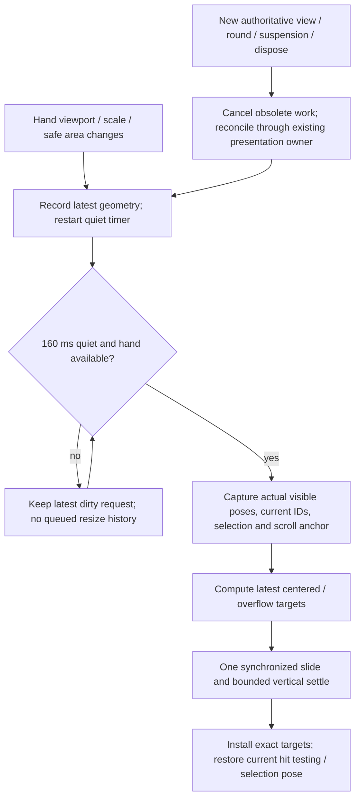

# Centered hand spacing and delayed resize reflow

## Goal Capsule

Keep the player's dominoes together as a centered hand with a maximum inter-tile gap, and fix stale hand positions after resizing. Once resizing pauses, slide the current hand smoothly to its new positions with a small, coordinated vertical settle when space permits. Tiles must not cross or visibly overlap during this reflow.

This is a separate, focused implementation plan. It can ship before the wider [UI modernization plan](2026-10-18-1604-feat-modern-touch-friendly-gameplay-ui-plan.md), and owns hand spacing/resize motion where the two plans overlap. The wider plan still owns theme, typography, responsive HUD regions and native-point calibration. Creating this document makes no code, scene or animation changes.

---

## Evidence and current cause

The user's screenshot A is the narrower window and screenshot B the wider window. Both status lines report 16 tiles in the local hand, while fewer than 16 whole tiles are visible. The hand has conspicuously large gaps and edge clipping; the exact resize sequence and hidden tile identities cannot be established from still images. Use these screenshots as visual examples and reproduce the live resize before implementation.

Static source inspection identifies two concrete issues:

- `HandStrip` is in `Assets/Scripts/Game/Navigation/BoardGestures.cs`. For a fitting hand, `SpreadSpacing` and `X` deliberately distribute tiles over the full viewport width; there is a minimum spacing but no maximum gap. The existing normal-hand assertion in `Tests/BoardPresentation/Program.cs` explicitly preserves this behavior.
- `BoardNavigator.UpdateViewport` detects pixel size/UI scale/DPI changes and calls `ConfigureHand`, which changes the spacing model. Its `Apply` moves the hand root's scroll offset but does not recompute each tile's local position. `LayoutManager.GetHandLocalPositions` supplies updated positions only when a caller requests them. `GameplayPresenter` normally does that on Snap, initial deal, or a changed hand—not merely because the viewport changed. This explains how the model and displayed tiles can disagree after a resize.

Also inspect `PositionHelper.GetPlayerDominoYPosition`: the current hand baseline is derived from the screen bottom. Reflow must update Y as well as X and include bottom padding/safe areas. Do not fix the bug by repeatedly calling the full presenter Snap or replaying the deal animation.

This is source-based diagnosis plus user evidence, not a new runtime reproduction. No tests or builds were run while writing this plan.

---

## Product Contract

- R1. **Cap the space between tiles.** When the whole hand fits, center its actual content width inside the usable hand region; unused width becomes outer space. Do not cap outer margins and then stretch the tiles apart again.
- R2. **Retain readable overflow.** If the hand cannot fit at the minimum non-overlapping spacing, keep tile size/readability and horizontal scrolling. Ensure every tile, especially the selected tile and the two ends, can be brought fully into view. Do not shrink or overlap tiles just to display all of them at once.
- R3. **Reflow after resizing pauses.** Observe the latest hand-region geometry, debounce changes for an initial 160 ms, then animate to the latest layout. Window height, orientation, safe area, canvas/UI scale and future hand-tray size changes also invalidate the layout. Do not wait for a draw/play/server update to repair it.
- R4. **Gentle, bounded motion.** Start with a 320 ms slide and up to 80 ms of final settling; tune from normal-speed clips. Bounce is a small shared vertical offset, with no horizontal overshoot, scale inflation or rotation wobble. Skip the bounce when clearance or reduced-motion preference requires it.
- R5. **Preserve identity and interaction.** Retain tile order, tile IDs, selected tile and valid scroll/inspection context. Reflow does not sort the hand or emit a game command. Hit tests must match visible poses; temporarily suppress only hand tile selection during the actual reflow, rather than allowing a click to target an old location.
- R6. **One owner of hand motion.** Resize, selection lift, draw/reveal, placement, undo, cancellation and resynchronization cannot write the same transform concurrently. Authoritative updates and their existing reconciliation always take priority.
- R7. **No overlapping reflow.** Check projected tile-body footprints throughout movement, not only center positions/final transforms. Reserve vertical room within the hand region for selected-tile lift and bounce. No tile may enter the board/control region because of the settle effect.
- R8. **Verify the real bug.** Capture actual desktop-window resizing and touch/orientation cases, separately from offscreen viewport simulations. Record user visual acceptance separately from automated checks.

### Acceptance examples

- AE1. With 1, 2, 5 or 16 tiles and ample width, the hand is centered, gap never exceeds its cap, and enlarging the window primarily increases outer whitespace.
- AE2. Resize narrow → wide → narrow while holding the same 16-tile recipient view. After each quiet interval all tiles move to the correct current baseline/spacing. No server command, hand-count change or full Snap is needed.
- AE3. A 60-tile stress hand remains scrollable with fixed readable tile size. Resizing across the fitting/overflow threshold preserves a useful anchor; once it fits it centers with zero scroll offset.
- AE4. A selected tile stays selected and visibly raised after reflow. A draw, accepted placement or suspension arriving during debounce/motion cancels or supersedes obsolete targets without leaving tiles stranded or restoring old IDs.

Scope excludes a hand-sorting feature, drag-to-place, new player states, typography/theme redesign, core rules/network changes, general board/train choreography, package upgrades and final-art import. Existing animation assets and the UI modernization plan must remain usable; create a hand-reflow-specific editable curve/settings rather than changing a shared easing curve globally.

---

## Planning Contract

### Centered spacing policy

Compute in one hand coordinate space, with a hand viewport derived from the camera and current usable UI/safe-area region. Initially adapt the current camera/hand margins; later the modern HUD can supply its actual tray rectangle. Center on that rectangle, which may not be the physical screen center when insets or panels are asymmetric.

Definitions: `n` = tile count; `w` = measured hand-facing tile-body width; `A` = usable width after left/right padding; `gMin` / `gMax` = minimum/maximum edge-to-edge gap. Start tuning at `gMin = 0.08 × w`, `gMax = 0.16 × w`; these ratios are recommendations, not hardware-independent pixel sizes. Keep the cap configurable and validate the actual rendered tile footprint with the current art/rotation.

For `n > 1`, choose center pitch `s = clamp((A − w)/(n − 1), w + gMin, w + gMax)` and content width `C = w + (n − 1) × s`. If `C ≤ A`, centers are `centerX + (i − (n − 1)/2) × s`. One tile goes at center; zero tiles produce no positions. Guard invalid/zero-sized viewports without division or NaNs; re-evaluate when a usable viewport returns. A supported usable hand rect must fit at least one readable tile plus padding vertically and horizontally. If minimization/extreme resizing violates that minimum, retain only the latest dirty request and disable hand hit testing until the rect becomes usable; do not shrink tiles, generate impossible targets or count that interval as successful fitting-hand visibility.

When `C > A`, use minimum pitch and existing bounded scroll semantics. Preserve the selected tile's visual anchor when possible; otherwise preserve the first fully visible tile and its relative position, then clamp. Keep manual scroll position when still valid. On overflow → fitting, animate to the centered layout and zero offset rather than snapping the root mid-slide. Reflow and root-offset animation must be computed together so the scroll offset is not applied twice.

Do not modify the generic legacy `PositionHelper` spread methods for unrelated callers as a shortcut. Make `HandStrip` the hand-spacing source of truth and have initial deal, draw/return, removal and resize use the same geometry.

### Resize scheduling and ownership

This is a local presentation job, not a player-state diagram. It never advances turns or alters the pending-command slot.

Proposed owner: a small `HandReflowController` coordinated by `GameplayPresenter`/`LayoutManager`, with a pure `HandLayoutPolicy`/schedule model where useful. `BoardNavigator` publishes actual geometry invalidation rather than silently mutating only the model. Avoid recomputing/restarting a reflow every frame when the geometry is unchanged; compare dimensions, safe rect, scale and hand-region origin, not just screen width.

Update board viewport bounds/clipping immediately when necessary, but keep desired hand geometry separate from presented hand poses during debounce. In particular, do not let `ConfigureHand` clamp and jump `HandRoot` to its new offset before tile movement begins. Retarget from the currently rendered poses, not a previous animation's destinations. Multiple changes coalesce to one latest job; they never build an unbounded coroutine queue.

Use unscaled time for the quiet timer and cosmetic resize movement. Unity/platform window resizing may pause rendering on some paths: characterize that first, and schedule the reflow from the first usable geometry updates after rendering resumes. No promise of continuous animation while the OS itself blocks game frames.

If a gameplay presentation owns hand transforms, retain one dirty resize request and process it against the latest stable recipient view after that ownership is released. If a new authoritative hand change interrupts resize movement, cancel the resize job before its existing presentation runs, remove any temporary bounce offset, and regenerate targets from current IDs afterward. Round/match reset, suspension, terminal reconciliation and disposal invalidate the local job generation. Late callbacks cannot unlock another job or resurrect a removed tile.

Explicit hand scrolling takes priority over cosmetic reflow. During debounce, wheel/trackpad/touch-pan uses the currently presented hand geometry and updates the pending scroll anchor. During an active overflow reflow, a hand-scroll gesture interrupts the horizontal slide at its actual visible positions; the single hand-motion owner applies the requested scroll delta/clamp using that presented geometry and gently removes the shared bounce. Do not route a second independent `PanHand`/`Apply` transform writer around this owner. While the gesture is active, keep the presented spacing stable, retain the latest dirty geometry and restart the quiet timer after the gesture ends. The next reflow preserves the user's newest inspected anchor rather than automatically scrolling back to a previously selected tile. A fitting presented hand ignores unnecessary horizontal pan; board pan/zoom remains independent. Add a short guard so the gesture that interrupted motion cannot also select a tile.

Selection lift becomes an offset composed with the current hand baseline, not another independent XY coroutine. Preserve selection without replaying its click sound. Block hand-tile tap/select only while its visible geometry is moving; retain board navigation and supported Announce/Challenge. A placement using an already-selected tile can still be submitted through existing permissions; the resulting authoritative view cancels hand reflow before moving that tile. Never extend a challenge window or delay receipt of accepted state for this animation.

### Safe slide and gentle settle

For a stable cohort of tiles in unchanged order/size/hand rotation, use the same monotonic normalized horizontal progress for every tile. Each adjacent separation is then a weighted average of its initial and final separations; if both are safe, the slide stays ordered and separated. Do not independently stagger horizontal springs or use an overshooting easing curve, because that removes this property.

Add one shared vertical settle curve: start/end at zero, a small upward lift followed by a weaker second lift, and smooth endpoint velocities. Initial amplitude: at most 3 logical UI units or 4% of hand tile height, whichever is smaller, further clamped to available clearance. Keep selection lift as a separate stable offset. All hand tiles share that bounce phase, so it does not change their horizontal separation. Reduce amplitude to zero where needed; the non-overlap requirement outranks the decorative bounce.

This geometric argument covers only the stable hand-row cohort. It does not prove safety for perspective depth/scale changes, incoming rotated tiles, already-invalid starting poses or a tile simultaneously leaving for a train. Freeze hand depth/rotation/scale during the narrow resize slide, defer while another hand motion owns a tile, and validate actual projected corners/bounds. If starting hand poses already intersect, first establish a separated layout through a documented safe recovery path (or snap to valid latest geometry when motion cannot safely recover); do not label a failing interval as collision-free. A recovery snap is distinct from the ordinary resize animation and must be recorded.

Bounce stays inside a padded hand band and must not pass through resting board tiles. Avoid fake depth offsets that make bodies appear to overlap. A reduced-motion/configuration flag uses a short non-bouncing slide or immediate reconciliation through the same completion/cleanup path. This focused plan does not add a new settings GUI; consume the wider UI plan's preferences if present.

---

## Implementation Units

### U1. Fix and characterize the spacing model

- **Covers:** R1, R2, R5; AE1/AE3.
- **Files:** `Assets/Scripts/Game/Navigation/BoardGestures.cs` (`HandStrip`), `BoardNavigator.cs`, `Assets/Scripts/Game/LayoutManager.cs`; `Tests/BoardPresentation/Program.cs`.
- **Approach:** add configurable maximum gap, center fitting content, preserve minimum spacing/scroll semantics and stable anchors. Replace the existing full-width-spread expectation intentionally; keep all other board/follow/gesture checks.
- **Execution note:** add a failing capped-gap/centered-hand regression before changing behavior. Check the actual rotated footprint rather than assuming prefab dimensions match the hand face.
- **Scenarios:** counts 0/1/2/5/16/60; extremely wide and narrow viewports; asymmetric padding; exact-fit threshold on both sides; invalid/zero width; negative settings clamped safely; fitting↔overflow with selected/first-visible anchor. Assert max/min gaps, centered bounds, no overlap, complete reachability and no tile-ID/order changes.
- **Done when:** focused source-linked layout checks pass, and all existing hand entry paths consume the same policy. No visual-acceptance claim from numeric positions alone.

### U2. Repair resize invalidation and coordinated hand motion

- **Depends on:** U1. **Covers:** R3, R5, R6; AE2/AE4.
- **Files:** `BoardNavigator.cs`, `LayoutManager.cs`, `GameplayPresenter.cs`, `GameplayManager.cs`, `InputManager.cs` where local hand hit-test gating is needed; proposed `Assets/Scripts/Game/Navigation/HandReflowController.cs`; proposed `Tests/BoardPresentation/HandReflowChecks.cs` linked by its maintained project.
- **Approach:** geometry-change notification, separate desired/presented hand layouts, latest-only debounce, explicit single hand-motion ownership, actual-pose retargeting and generation-based cancellation. Do not use a full gameplay Snap or a fake recipient view as a resize callback. Preserve state subscriptions and existing command flow; no state-class edits are anticipated.
- **Execution note:** first demonstrate the stale-position failure with the same unchanged view across a real resize; then add a fake-clock scheduling regression. Avoid real sleeps for timer tests.
- **Scenarios:** quiet threshold just before/after 160 ms, continuous resize bursts, shrink/widen during an active reflow, height-only change, safe-area/scale change without pixel-size change, minimized/restored window, panned hand, selected tile, wheel/trackpad/touch-pan during debounce and active reflow (user intent wins with no second transform writer), draw/undo/placement while dirty or moving, suspension/reset/disposal and late completion. No pending request or command is manufactured by resizing.
- **Done when:** latest hand targets are applied without a server update, jobs coalesce/cancel correctly and actual-pose hit testing/selection remains coherent.

### U3. Add bounded settle motion and separation checks

- **Depends on:** U2. **Covers:** R4, R6, R7.
- **Files:** `LayoutManager.cs`, hand reflow controller/model, `Assets/Scripts/Helpers/AnimationHelper.cs` only for narrowly reusable behavior; a new hand-reflow `AnimationDefinition` asset created through the Editor; `Tests/Motion/Program.cs` and proposed `Tests/Motion/HandReflowChecks.cs`.
- **Approach:** shared monotonic slide progress, shared vertical settle, clearance clamp and reduced-motion behavior. Preserve GUIDs/existing curves; do not mutate the current deal variation or unrelated global easing to obtain bounce.
- **Scenarios:** expanding/contracting rows, selected lift, large/small gaps, no vertical bounce room, interrupted settle, reduced motion, different render frame rates and fixed hand depth/scale. Sample every adjacent projected body footprint; include first/last tiles and resting board/control bounds. Exclude only actual clipped/offscreen geometry, never an overlapping visible body. Verify exact final pose and no residual offset after cancellation.
- **Done when:** timing/separation checks pass, Unity projected-footprint diagnostics pass for resize fixtures, and clips show a subtle settle. Samples flag likely intersections but cannot prove absence between frames; frame-step flagged intervals and retain human review.

### U4. Capture real-window regression and review

- **Depends on:** U1–U3. **Covers:** R8 and AE1–AE4.
- **Files:** `Tests/UnityIntegration/ViewRuntime.cs`, `ReviewRuntime.cs`, `run_review.py` or a focused resize runner; new `Tests/UnityIntegration/HAND_REFLOW_VERIFICATION.md`; update relevant current hand notes in `Assets/Docs/PROJECT_STATE.md`/`TASKS.md` only after evidence exists.
- **Approach:** keep the recipient hand unchanged while resizing real desktop windows narrower and wider; separately test offscreen geometry to isolate calculations. Extend capture metadata with actual client-area dimensions, hand rect, count, selected ID, scroll anchor, debounce/reflow timing and projected bounds. Keep media outside tracked Assets.
- **Scenarios:** reproduce the two supplied screenshot shapes (capture actual window client dimensions rather than assuming attachment pixels equal them); 1280×720, 1920×1080 and 2532×1170; compact portrait/narrow fixtures; 1–3, 5, 16 and overfull hands; actor and waiting perspectives over localhost; iPad orientation/safe area with real touch when available. Resize during selection/deal/draw/undo/accepted placement and cancellation; interrupt overflowing-hand reflow with wheel, trackpad and touch-pan, then verify the newest inspected anchor survives. Require all fitting tiles fully visible after settling, including bottom values.
- **Done when:** paired before/after PNGs, normal-speed clips, timing/raycast/footprint receipts and user-reviewed findings exist. Real iPad/trackpad cases remain explicitly unreviewed if unavailable; offscreen probes cannot close actual-window verification.

---

## Verification Contract and Definition of Done

During implementation, use the existing commands documented in `RulesEngine/README.md`, `Assets/Docs/STATE_MACHINE_DEBUGGING.md` and `Tests/UnityIntegration/README.md`. Run focused BoardPresentation/Motion checks first, then relevant client/state/adapter regressions and actual Unity resize scenarios. Recheck CLI and Editor license separately; no new live service run is needed for this local presentation fix. Preserve packages, core rules, scene development settings, asset GUIDs and unrelated working-tree changes.

The fix is complete when fitting hands remain centered with capped gaps, overflowing hands remain readable/reachable, and actual window changes trigger a delayed coordinated reflow without hand-count changes or server updates. No ordinary resize sequence shows overlapping bodies, horizontal crossover, clipped fitting-hand values, stale hit targets, duplicate transform writers or a stuck presentation/input mask. The settle is visually gentle and suppresses itself when unsafe; reduced motion and interruption cleanup work.

Record automated-pass, failed, user-reviewed and unreviewed results separately. A tuned bounce or passing numeric suite alone does not complete the visual requirement. Coordinate the hand-related sections with the wider UI plan without starting that broader redesign as part of this fix. Do not mark the overall VIEW-003/QA-003/final-art gate complete from these focused results.

## Sources and deferred tuning

Grounding: the two user screenshots supplied in this conversation; source/characterization files named above; `Tests/UnityIntegration/GAMEPLAY_GAP_VERIFICATION.md`; the existing UI modernization and gameplay-review plans. This is internal source-based planning; no external research was needed for the capped-spacing policy or reported resize path.

Nonblocking implementation tuning: final gap ratios, 160 ms debounce, 320+80 ms slide/settle and bounce amplitude should be adjusted from the user's real-window clips while preserving centering, responsiveness and separation. The physical iPad window/safe-area values and any render-loop pause during native window dragging must be measured, not guessed. No implementation, behavioral tests or new runtime verification were performed for this plan.
